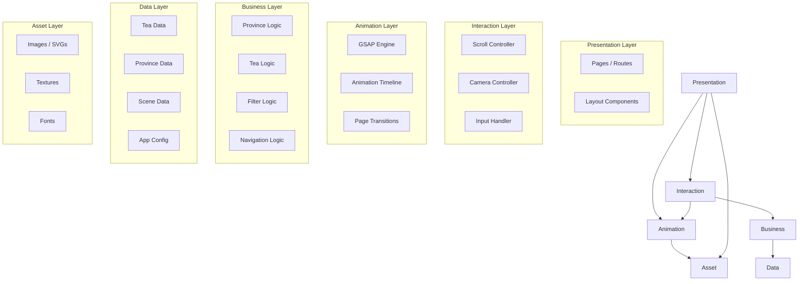
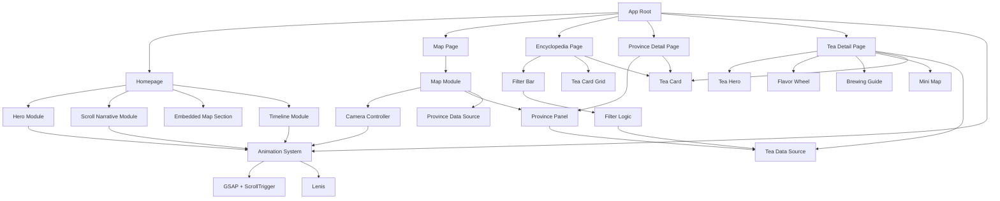
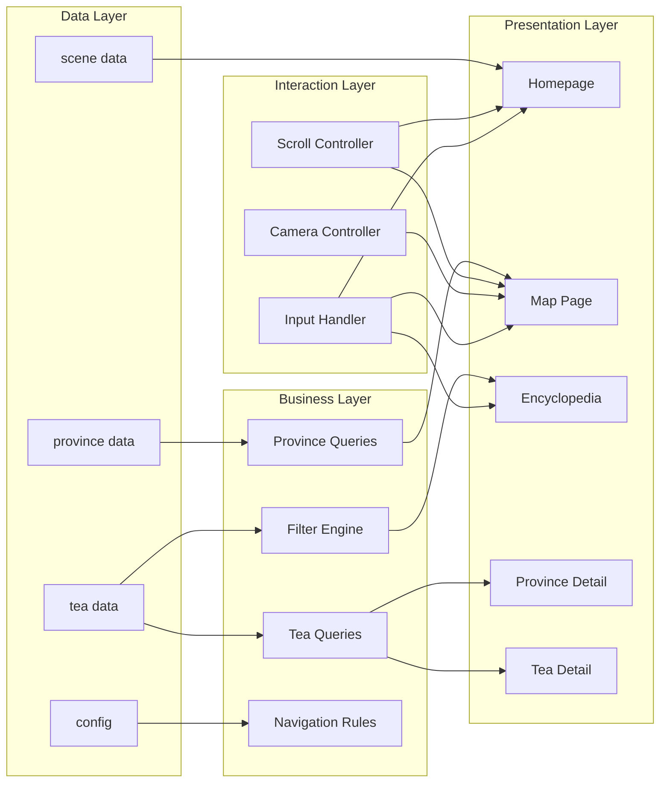
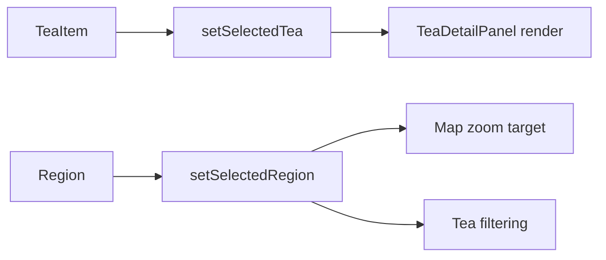

# 03 — Site Architecture

> Tea Atlas: Interactive Chinese Tea Culture Digital Museum

---

## 1. Document Information

| Field | Value |
|---|---|
| **Document ID** | SA-003 |
| **Version** | 1.0 |
| **Status** | Draft |
| **Last Updated** | 2026-07-05 |
| **Related Documents** | `01-product-requirements.md`, `02-information-architecture.md`, `04-ui-design-system.md`, `05-animation-system.md`, `09-frontend-architecture.md` |

---

## 2. Architecture Overview

Tea Atlas follows a **six-layer architecture**. Each layer has a single responsibility and a defined interface to adjacent layers. The layered model replaces a traditional page-based architecture — pages are a concern of the Presentation Layer only.



---

## 3. Layered Architecture

### 3.1 Layer Definitions

| Layer | Responsibility | Input | Output | Depends On |
|---|---|---|---|---|
| **Presentation** | Render UI; define page structure; compose components | User events; data from Business Layer | Rendered DOM | Business Layer, Asset Layer |
| **Interaction** | Handle scroll, click, hover, keyboard; translate raw input to semantic actions | Raw browser events | Semantic action descriptors | Animation Layer |
| **Animation** | Execute all motion; manage GSAP timelines; coordinate transitions | Semantic action descriptors from Interaction Layer | Animated property changes | Asset Layer |
| **Business** | Domain logic: filtering, navigation rules, content selection | Queries from Presentation Layer | Processed data | Data Layer |
| **Data** | Store and serve all structured content; provide query interface | Static data files | Typed data objects | None (leaf) |
| **Asset** | Serve images, textures, fonts, SVGs | Asset path references from Presentation/Animation | Loaded assets | None (leaf) |

### 3.2 Layer Communication Rules

| ID | Rule | Priority |
|---|---|---|
| LAY-R01 | Layers communicate only with adjacent layers (no skipping) | P0 |
| LAY-R02 | Data flows down through layers; events flow up | P0 |
| LAY-R03 | The Asset Layer is an exception — Presentation may access it directly for static images | P0 |
| LAY-R04 | The Animation Layer never accesses the Data Layer directly | P0 |
| LAY-R05 | The Business Layer never accesses the DOM | P0 |
| LAY-R06 | The Interaction Layer never contains animation property values | P0 |

### 3.3 Interaction Flow Specification

Map interactions are semantic events owned by the Interaction Layer. They may request state updates or animation actions, but they do not mutate rendered map geometry directly.

| Interaction | Behavior | State Change | Rendering / Effect Boundary | Priority |
|---|---|---|---|---|
| **Region hover** | Highlight the hovered region as visual feedback only | None | May apply hover styling through Presentation/Animation tokens; must not change `selectedRegion`, filters, camera, or tea selection | P0 |
| **Region click** | Select the region, zoom camera to the region, and filter teas by region | `setSelectedRegion(regionId)` | Camera zoom is requested through the map/camera controller; filtered tea data is derived from `selectedRegion` | P0 |
| **Tea click** | Select a tea item and open the tea detail panel | `setSelectedTea(teaId)` or `setSelectedTea(tea)` | Detail panel renders from `selectedTea`; map rendering remains derived from data and controller state | P0 |

Interaction rules:

| ID | Rule | Priority |
|---|---|---|
| INT-R01 | Hover interactions are visual-only and never commit application state | P0 |
| INT-R02 | Region clicks are the only map-region interaction that may update `selectedRegion` | P0 |
| INT-R03 | Tea clicks are the only tea-item interaction that may update `selectedTea` | P0 |
| INT-R04 | UI components dispatch semantic intents (`selectRegion`, `selectTea`, `resetCamera`) instead of mutating SVG, canvas, or map transforms directly | P0 |
| INT-R05 | Map zoom and tea filtering are derived consequences of `selectedRegion`, not separate competing state sources | P0 |

---

## 4. Module Dependency Graph



### 4.1 Dependency Rules

| ID | Rule | Priority |
|---|---|---|
| DEP-R01 | No circular dependencies between modules | P0 |
| DEP-R02 | Components in `components/` may not import from `pages/` | P0 |
| DEP-R03 | Animation utilities may not import from Business Layer | P0 |
| DEP-R04 | Data files may not import from any other layer | P0 |
| DEP-R05 | Shared components may not depend on page-specific components | P0 |
| DEP-R06 | The Tea Card component is shared across Encyclopedia, Province Detail, Tea Detail | P0 |

---

## 5. Component Ownership

### 5.1 Component → Page Ownership

| Component | Owner Module | Shared? | Related Requirements |
|---|---|---|---|
| **Hero** | Homepage | No | FR-H-01 – FR-H-08 |
| **Scene Section** | Homepage / Scroll Narrative | No | FR-S-01 – FR-S-08 |
| **Map** | Map Module | Yes (Homepage + Map Page) | FR-M-01 – FR-M-10 |
| **Camera Controller** | Map Module | No | FR-M-02, FR-M-03, FR-M-04 |
| **Province Panel** | Province Detail Module | Yes (Map Page + Province Page) | FR-M-04, FR-P-01 – FR-P-07 |
| **Timeline** | Homepage / Timeline Module | No | FR-TL-01 – FR-TL-06 |
| **Filter Bar** | Encyclopedia | No | FR-E-03 – FR-E-05, FR-E-08, FR-E-09 |
| **Tea Card** | Encyclopedia | Yes (Encyclopedia + Province + Tea Detail) | FR-E-02, FR-E-06, FR-E-07 |
| **Tea Card Grid** | Encyclopedia | No | FR-E-01 |
| **Tea Hero** | Tea Detail | No | FR-TD-01 |
| **Flavor Wheel** | Tea Detail | No | FR-TD-03 |
| **Brewing Guide** | Tea Detail | No | FR-TD-05 |
| **Mini Map** | Map Module | Yes (Tea Detail + Province Detail) | FR-TD-06, FR-P-06 |
| **Navigation Bar** | App Root / Global | Yes (All pages) | FR-N-01 – FR-N-06 |
| **Page Transition** | App Root / Global | Yes (All pages) | AR-10, AR-11 |
| **Fog Layer** | Visual Effects | Yes (Homepage + Map Page) | AR-12 |
| **Parallax Container** | Visual Effects | Yes (Homepage scenes) | AR-13 |

### 5.2 Visual Layer Components

These components do not belong to any page. They are ambient effects controlled by the Animation Layer.

| Component | Owner | Trigger | Related Requirements |
|---|---|---|---|
| **Fog Layer** | Visual Effects Module | Continuous; scroll-driven opacity | AR-12 |
| **Ink Layer** | Visual Effects Module | Scene transitions | FR-H-01, AR-01 |
| **Particle Field** | Visual Effects Module | Scroll position (certain scenes) | AR-12 |
| **Parallax Container** | Visual Effects Module | Scroll position | AR-13, FR-S-06 |

---

## 6. File Ownership

### 6.1 Directory Structure

```
src/
├── components/           # Reusable UI components (shared across pages)
│   ├── tea-card/         # TeaCard — used by Encyclopedia, Province, Detail
│   ├── filter-bar/       # FilterBar — used by Encyclopedia
│   ├── navigation/       # NavigationBar — used by all pages
│   ├── page-transition/  # PageTransition — used by App root
│   ├── province-panel/   # ProvincePanel — used by Map, Province Detail
│   ├── mini-map/         # MiniMap — used by Tea Detail, Province Detail
│   ├── flavor-wheel/     # FlavorWheel — used by Tea Detail
│   ├── brewing-guide/    # BrewingGuide — used by Tea Detail
│   ├── empty-state/      # EmptyState — used by Encyclopedia
│   └── scroll-indicator/ # ScrollIndicator — used by Hero
│
├── pages/                # Page-level components (one per route)
│   ├── homepage/         # Homepage — Hero + Scenes + Map + Timeline
│   ├── map-page/         # MapPage — full map view
│   ├── encyclopedia/     # Encyclopedia — filter + grid
│   ├── province-detail/  # ProvinceDetail
│   └── tea-detail/       # TeaDetail
│
├── modules/              # Feature modules (business logic + specific components)
│   ├── hero/             # Hero — animation orchestration, layers
│   ├── scenes/           # ScrollNarrative — scene sections, triggers
│   ├── map/              # Map — SVG map, camera, province interaction
│   ├── timeline/         # Timeline — horizontal scrub, stage components
│   └── effects/          # VisualEffects — fog, particles, parallax
│
├── animation/            # Animation System (GSAP, ScrollTrigger, Lenis)
│   ├── engine.ts          # GSAP initialization, globals
│   ├── scroll-controller.ts  # Lenis setup, scroll normalization
│   ├── transitions.ts     # Page transition animations
│   ├── presets.ts         # Reusable animation presets (fadeIn, scaleUp, etc.)
│   ├── hero-timeline.ts   # Hero animation timeline definition
│   ├── scene-triggers.ts  # Scroll scene trigger definitions
│   ├── map-animations.ts  # Camera zoom, pan animations
│   └── timeline-scrub.ts  # Tea growth timeline scrub animation
│
├── data/                 # Data Layer (static content)
│   ├── teas.ts            # All tea point data
│   ├── provinces.ts       # All province data
│   ├── scenes.ts          # Scroll narrative scene data (text, config)
│   ├── timeline-stages.ts # Tea growth timeline stage data
│   ├── tea-types.ts       # Tea type enum + metadata
│   ├── flavor-profiles.ts # Flavor profile definitions
│   └── config.ts          # App configuration (nav items, defaults)
│
├── business/             # Business Layer
│   ├── filter-engine.ts   # Tea filtering logic
│   ├── navigation-rules.ts # Navigation guard logic
│   ├── tea-queries.ts     # Tea data queries (byProvince, byType, etc.)
│   └── province-queries.ts # Province data queries
│
├── hooks/                # Custom React hooks
│   ├── use-scroll-position.ts
│   ├── use-camera-state.ts
│   ├── use-tea-filter.ts
│   ├── use-page-transition.ts
│   └── use-reduced-motion.ts
│
├── contexts/             # React Context providers
│   ├── scroll-context.ts      # Scroll position, lenis instance
│   ├── navigation-context.ts  # Current route, transition state
│   └── filter-context.ts      # Active filter state
│
├── styles/               # Global styles, design tokens, CSS utilities
│   ├── tokens.css         # Design tokens (CSS custom properties)
│   ├── global.css         # Reset, base styles, typography
│   ├── animations.css     # CSS-only fallback animations
│   └── textures.css       # Texture overlay classes
│
├── assets/               # Static assets (Asset Layer)
│   ├── images/
│   │   ├── hero/          # Hero background layers
│   │   ├── scenes/        # Scene background images
│   │   ├── provinces/     # Province atmosphere images
│   │   ├── teas/          # Tea illustrations
│   │   ├── textures/      # Rice paper, ink textures
│   │   └── map/           # Map-related images
│   ├── svg/
│   │   ├── map/           # China map SVG, province SVGs
│   │   ├── icons/         # UI icons
│   │   └── decorative/    # Tea leaves, calligraphy strokes
│   └── fonts/             # Custom font files
│
├── utils/                # Pure utility functions
│   ├── slug.ts            # URL slug generation
│   ├── scroll-math.ts     # Scroll position calculations
│   ├── easing.ts          # Easing function utilities
│   └── image-path.ts      # Asset path resolution
│
├── types/                # TypeScript type definitions
│   ├── tea.ts             # Tea, TeaType, FlavorProfile types
│   ├── province.ts        # Province, TeaRegion types
│   ├── scene.ts           # Scene, SceneConfig types
│   ├── map.ts             # MapState, CameraState, ProvinceGeo types
│   ├── animation.ts       # AnimationConfig, TransitionConfig types
│   └── navigation.ts      # Route, NavItem types
│
├── App.tsx               # Root component — layout, router, providers
├── main.tsx              # Entry point — mount App
└── vite-env.d.ts
```

### 6.2 Directory Rules

| ID | Rule | Priority |
|---|---|---|
| DIR-R01 | `components/` contains ONLY reusable UI components shared across 2+ pages | P0 |
| DIR-R02 | `pages/` contains page-level composition; page components delegate to modules | P0 |
| DIR-R03 | `modules/` owns feature-specific logic and non-reusable components | P0 |
| DIR-R04 | `animation/` is the single source of truth for all animation code | P0 |
| DIR-R05 | `data/` files export pure data objects — no functions, no side effects | P0 |
| DIR-R06 | `business/` contains pure functions only — no React imports | P0 |
| DIR-R07 | `assets/` is read-only after build — never modified at runtime | P0 |
| DIR-R08 | New files follow the existing directory pattern — no new top-level directories without architectural review | P0 |

---

## 7. Routing Architecture

### 7.1 Route Table

| Route | Page Component | Data Source | Transition | Priority |
|---|---|---|---|---|
| `/` | `Homepage` | `data/scenes.ts`, `data/teas.ts`, `data/provinces.ts` | None (scroll-driven, not a route transition) | P0 |
| `/map` | `MapPage` | `data/provinces.ts`, `data/teas.ts` | ANIM-010 (Page enter fade-up) | P0 |
| `/encyclopedia` | `Encyclopedia` | `data/teas.ts`, `data/tea-types.ts` | ANIM-010 | P0 |
| `/province/:slug` | `ProvinceDetail` | `data/provinces.ts` (by slug), `data/teas.ts` (by province) | ANIM-010 | P0 |
| `/tea/:slug` | `TeaDetail` | `data/teas.ts` (by slug) | ANIM-010 | P0 |
| `*` | Not Found (404) | — | ANIM-010 | P1 |

### 7.2 Route Transition Mapping

| From | To | Animation Reference | Priority |
|---|---|---|---|
| Homepage | Map Page | ANIM-010 + ANIM-011 | P0 |
| Homepage | Encyclopedia | ANIM-010 + ANIM-011 | P0 |
| Map Page | Province Detail | ANIM-010 + ANIM-011 | P0 |
| Encyclopedia | Tea Detail | ANIM-010 + ANIM-011 | P0 |
| Tea Detail | Encyclopedia | ANIM-010 + ANIM-011 | P0 |
| Province Detail | Map Page | ANIM-010 + ANIM-011 | P0 |
| Any | Any (nav bar) | ANIM-010 + ANIM-011 | P0 |

> Animation references point to `05-animation-system.md`. No animation property values are repeated here.

---

## 8. Data Flow

### 8.1 Data Flow Diagram



### 8.2 Data Access Patterns

| Page / Module | Data Needed | Access Method | Priority |
|---|---|---|---|
| Homepage — Hero | None (asset-driven) | Direct asset import | P0 |
| Homepage — Scenes | Scene data | `business/scene-queries.ts` → `data/scenes.ts` | P0 |
| Homepage — Map Section | Province summaries | `business/province-queries.ts` → `data/provinces.ts` | P0 |
| Homepage — Timeline | Timeline stage data | `data/timeline-stages.ts` (direct) | P0 |
| Map Page | All provinces, tea counts per province | `business/province-queries.ts` → `data/provinces.ts`, `data/teas.ts` | P0 |
| Encyclopedia | All teas (filtered) | `business/filter-engine.ts` → `data/teas.ts` | P0 |
| Province Detail | Single province, its teas | `business/province-queries.ts` → `data/provinces.ts`, `data/teas.ts` | P0 |
| Tea Detail | Single tea, related teas | `business/tea-queries.ts` → `data/teas.ts` | P0 |

### 8.3 Data Flow Contract

`selectedRegion` and `selectedTea` are core interaction state for the map and tea browsing experience. They are identifiers or typed data references, not imperative rendering handles.

| State | Owner | Set By | Read By | Derived Output |
|---|---|---|---|---|
| `selectedRegion` | Map Page / Map Module local state, or a route-level map context when shared | Region click intent | Map camera controller, filter logic, region-aware tea lists | Region zoom target, active region styling, filtered tea collection |
| `selectedTea` | Page or panel owner that renders tea details | Tea item click intent | Tea detail panel | Tea detail panel content and open/closed presentation |

Required data flows:



Contract rules:

| ID | Rule | Priority |
|---|---|---|
| DATA-R01 | `TeaItem -> setSelectedTea -> TeaDetailPanel render` is the only tea-detail opening path | P0 |
| DATA-R02 | `Region -> setSelectedRegion -> map zoom + filtering` is the only region-selection path | P0 |
| DATA-R03 | UI components never directly mutate map rendering, map camera transforms, SVG paths, or canvas draw state | P0 |
| DATA-R04 | Map rendering is derived from data, `selectedRegion`, camera state, and visual parameters; it is never the source of truth | P0 |
| DATA-R05 | Filtering uses stable tea/province identifiers; display labels are not used as state keys | P0 |

---

## 9. State Architecture

### 9.1 State Categories

| Category | Location | Persistence | Examples |
|---|---|---|---|
| **Route State** | URL | Session (via URL) | Current page, province slug, tea slug |
| **Scroll State** | `ScrollContext` | Session (in-memory) | Scroll position, scroll direction, active scene |
| **Camera State** | `Map Module` (local) | Session (in-memory) | Zoom level, pan position, selected province |
| **Map Selection State** | `Map Page` / `Map Module` | Session (in-memory) | `selectedRegion`, `selectedTea` |
| **Filter State** | `FilterContext` + URL params | Session (in-memory + URL sync) | Active type filter, active region filter |
| **Animation State** | `animation/engine.ts` | Session (in-memory) | Active timelines, completion status |
| **UI State** | Component-local | Session (in-memory) | Hover states, focus states, panel open/close |

### 9.2 State Rules

| ID | Rule | Priority |
|---|---|---|
| ST-R01 | All shared state lives in Context, not props drilling beyond 2 levels | P0 |
| ST-R02 | Route state is the source of truth for "what page am I on" | P0 |
| ST-R03 | Filter state is synced to URL query params | P1 |
| ST-R04 | Animation state never triggers re-renders — use refs, not state | P0 |
| ST-R05 | Scroll position is read from Lenis, not from browser scroll APIs | P0 |
| ST-R06 | No global state store (Redux, Zustand) unless Context becomes a proven bottleneck | P0 |

---

## 10. Design Token References

> All visual properties are defined in `04-ui-design-system.md`. This architecture references tokens by name only — no raw values.

| Usage | Token Reference |
|---|---|
| Page background color | `Color.Surface.Primary` |
| Text color | `Color.Text.Primary` |
| Navigation bar background | `Color.Surface.Nav` |
| Hero background | `Color.Ink.Base` |
| Card background | `Color.Surface.Card` |
| Province highlight color | `Color.Accent.Region` |
| Active filter chip | `Color.Accent.Active` |
| Page transition duration | `Motion.Duration.PageTransition` |
| Card hover scale | `Motion.Transform.HoverScale` |
| Border radius (cards) | `Radius.Card` |
| Border radius (chips) | `Radius.Chip` |
| Title font size (page) | `Typography.Title.XL` |
| Title font size (card) | `Typography.Title.S` |
| Body text size | `Typography.Body.M` |
| Spacing (section) | `Spacing.Section.Vertical` |
| Spacing (card gap) | `Spacing.Grid.Gap` |

---

## 11. Animation Architecture

> All animations are owned by `animation/`. Pages and components never define animation properties directly. They reference animation IDs from `05-animation-system.md`.

### 11.1 Animation Ownership Map

| Animation ID | Owned By File | Triggered By | Priority |
|---|---|---|---|
| ANIM-001 – ANIM-008 | `animation/hero-timeline.ts` | Page load / scroll skip | P0 |
| ANIM-010, ANIM-011 | `animation/transitions.ts` | Route change | P0 |
| ANIM-012, ANIM-013 | `animation/scene-triggers.ts` | Scroll position | P0 |
| ANIM-014, ANIM-015 | `animation/map-animations.ts` | Province click / back click | P0 |
| ANIM-016 – ANIM-019 | `animation/timeline-scrub.ts` | Horizontal scroll | P0 |
| ANIM-020 – ANIM-023 | `animation/presets.ts` (reusable) | Various (card hover, filter, etc.) | P0 |

### 11.2 Animation Rules

| ID | Rule | Priority |
|---|---|---|
| ANIM-R01 | All animation code lives in `animation/` — never in components or pages | P0 |
| ANIM-R02 | Components request animations by ID, not by property values | P0 |
| ANIM-R03 | `animation/presets.ts` defines reusable patterns (fadeIn, scaleUp, slideIn) | P0 |
| ANIM-R04 | `prefers-reduced-motion` is checked once at engine init; all animations downgrade | P0 |
| ANIM-R05 | GSAP timelines are killed on unmount — no leaked animations | P0 |
| ANIM-R06 | Lenis is a singleton — initialized once, destroyed on app unmount | P0 |

### 11.3 Effect System Contract

The effect system is a visual parameter system, not a UI state system. Season is treated as a visual preset that influences effect parameters such as color, density, opacity, and transition tone. UI components must not expose season mutation controls or directly mutate effect modules.

`EffectController` is the single entry point for all runtime visual effects. Pages and components send semantic effect requests or parameter presets to `EffectController`; individual effect modules do not receive UI events directly.

| Module | Responsibility | Input | Output |
|---|---|---|---|
| `EffectController` | Own effect orchestration, lifecycle, reduced-motion downgrade, and module coordination | Visual preset, route/scene context, semantic effect requests | Normalized effect parameters passed to modules |
| `BloomEffect` | Render bloom/flower visual treatment where enabled by scene or route capability | Bloom preset parameters from `EffectController` | Bloom visuals only; no application state changes |
| `AtmosphereEffect` | Render ambient fog, clouds, wash, and environmental tone | Atmosphere preset parameters from `EffectController` | Ambient visual layer |
| `ParticleEffect` | Render particles such as snow, pollen, dust, or ink flecks | Particle preset parameters from `EffectController` | Particle visual layer |
| `TransitionEffect` | Coordinate visual transitions between routes, scenes, or presets | Transition preset parameters from `EffectController` | Enter/exit/preset transition visuals |

Effect rules:

| ID | Rule | Priority |
|---|---|---|
| EFX-R01 | Season is not UI state; it is a visual parameter preset consumed by `EffectController` | P0 |
| EFX-R02 | `EffectController` is the only public entry point for effect orchestration | P0 |
| EFX-R03 | `BloomEffect`, `AtmosphereEffect`, `ParticleEffect`, and `TransitionEffect` never mutate `selectedRegion`, `selectedTea`, filters, route state, or map camera state | P0 |
| EFX-R04 | UI components may request semantic transitions, but may not directly call effect module internals | P0 |
| EFX-R05 | Effect modules render visual output only and must degrade through the shared reduced-motion policy | P0 |

---

## 12. Build & Deployment Architecture

| Aspect | Decision | Priority |
|---|---|---|
| Build tool | Vite (already adopted) | P0 |
| Output | Static site (HTML + JS + CSS + assets) | P0 |
| Asset hashing | Vite default (content-hash in filenames) | P0 |
| Code splitting | Route-based lazy loading via `React.lazy` | P0 |
| Image optimization | Vite asset pipeline; no external CDN required | P1 |
| Deployment target | Any static host (Vercel, Netlify, Cloudflare Pages, S3) | P0 |
| Environment variables | `import.meta.env` (Vite convention) | P0 |

---

## 13. Scalability

### 13.1 Extension Points

| Scenario | What Changes | What Does NOT Change |
|---|---|---|
| **Add new tea** | Add entry in `data/teas.ts` + images in `assets/images/teas/` | No component changes, no route changes |
| **Add new province** | Add entry in `data/provinces.ts` + add province path in SVG map + images | Map component renders new province automatically |
| **Add new timeline stage** | Add entry in `data/timeline-stages.ts` + illustration | Timeline component renders new stage automatically |
| **Add new scene** | Add entry in `data/scenes.ts` + scroll trigger + images | Scene container iterates over scene data array |
| **Add new language** | Add locale data files; add locale context; swap text references | All components remain the same; data-driven text |
| **Add new filter dimension** | Add filter option type; add UI chip row; add filter logic | Filter engine supports extensible dimensions |
| **Add new page / exhibit** | Add route, page component, data file | Navigation bar auto-adds from config |
| **Mobile responsive** | Add CSS media queries; adjust animation parameters | HTML structure and component logic unchanged |

### 13.2 Architecture Principles for Extension

| ID | Principle | Priority |
|---|---|---|
| SC-R01 | Data drives UI — adding content never requires component changes | P0 |
| SC-R02 | Components render arrays — single-item and multi-item use the same code path | P0 |
| SC-R03 | Routes are configured, not hardcoded — adding a route is a config change | P0 |
| SC-R04 | Animations are parameterized — same animation, different targets and durations | P0 |
| SC-R05 | Filters are dimension-agnostic — the filter engine does not know about "tea type" specifically | P1 |

---

## 14. Risks

| ID | Risk | Impact | Likelihood | Mitigation |
|---|---|---|---|---|
| RISK-SA-01 | GSAP + Lenis + React lifecycle conflicts cause animation leaks | High | Medium | Strict mount/unmount cleanup; animation audit in Task001 |
| RISK-SA-02 | Route-based code splitting causes transition jank | Medium | Low | Preload adjacent routes; test on target devices |
| RISK-SA-03 | SVG map DOM complexity causes scroll lag on Map Page | Medium | Medium | Province detail SVGs loaded on demand; simplify paths |
| RISK-SA-04 | Six-layer architecture overengineered for current scope | Low | Medium | Layers are logical, not physical; no unnecessary abstraction files |
| RISK-SA-05 | Shared Tea Card component diverges across usage contexts | Medium | Low | Single component with variant props; no copy-paste forks |
| RISK-SA-06 | Filter state diverges from URL params | Low | Medium | Single sync direction (URL → state on load; state → URL on change) |

---

## 15. Constraints

| ID | Constraint |
|---|---|
| SA-C01 | Maximum bundle size per route chunk: 150KB gzipped |
| SA-C02 | Maximum SVG DOM nodes on Map Page: 3000 |
| SA-C03 | No state management library unless proven necessary by performance profiling |
| SA-C04 | No direct DOM manipulation outside `animation/` |
| SA-C05 | No inline styles with hardcoded values — use design token references |
| SA-C06 | No page component may exceed 300 lines |
| SA-C07 | Component files in `components/` must work in isolation (Storybook-compatible) |
| SA-C08 | Business logic functions must be pure and testable without React |

---

## 16. Acceptance Criteria

- [ ] Six-layer architecture is documented with clear responsibilities per layer
- [ ] Module dependency graph shows no circular dependencies
- [ ] Every core component has a defined owner module
- [ ] Directory structure maps to layered architecture (not page structure)
- [ ] Route table covers all 5 pages + 404
- [ ] Data flow diagram shows unidirectional data access
- [ ] Interaction flow defines region hover, region click, and tea click contracts
- [ ] Data flow contract defines `selectedRegion`, `selectedTea`, and derived map/filter/detail rendering
- [ ] State architecture defines ownership for each state category
- [ ] Effect system contract defines season as a visual preset and `EffectController` as the single effects entry point
- [ ] Design token references are used throughout (no raw values)
- [ ] All animations reference IDs from `05-animation-system.md` (no inline animation values)
- [ ] Scalability section covers 8 extension scenarios with clear change/no-change boundaries
- [ ] All SA-C* constraints are verifiable
- [ ] Risk mitigation strategies are actionable

---

## 17. Open Questions

| ID | Question | Impact | Resolution Needed By |
|---|---|---|---|
| SA-Q01 | Should the embedded homepage map share the same Map component instance as the `/map` page, or be a lighter variant? | Bundle size, scroll performance | Before Task: Homepage Map Section |
| SA-Q02 | Should filter state survive a full page reload via URL, sessionStorage, or be reset? | User experience for deep-linked filtered views | Before Task: Encyclopedia |
| SA-Q03 | Should Lenis be destroyed and recreated on route change, or persist as a singleton? | Scroll behavior on non-homepage routes | Before Task: Scroll Controller |
| SA-Q04 | At what scroll length threshold does the homepage become a performance problem? | Scene count, image preloading strategy | Before Task: Homepage Scenes |
| SA-Q05 | Should the Animation Layer expose a programmatic API (`.play()`, `.pause()`) or be purely declarative? | How components trigger animations | Before Task: Animation Engine |

---

## 18. References

| Document | Relationship |
|---|---|
| `01-product-requirements.md` | All FR-* and NFR-* requirements drive architecture decisions |
| `02-information-architecture.md` | IA content hierarchy and navigation model define page/route structure |
| `04-ui-design-system.md` | Design tokens referenced throughout this document |
| `05-animation-system.md` | All ANIM-* IDs referenced here are defined there |
| `09-frontend-architecture.md` | Translates this logical architecture into concrete file structure |
| `16-data-schema.md` | Formal schema for all data types referenced in Data Layer |
| `17-state-management.md` | Detailed state architecture and context definitions |

---

## 19. Implementation Checklist

- [ ] SA-001: Six-layer architecture diagram reviewed and approved
- [ ] SA-002: Module dependency graph verified (no cycles)
- [ ] SA-003: Component ownership mapped for all 17 components
- [ ] SA-004: Directory structure created in project
- [ ] SA-005: Route table implemented in React Router
- [ ] SA-006: Data Layer files created with typed exports
- [ ] SA-007: Business Layer query functions implemented
- [ ] SA-008: Context providers created (Scroll, Filter, Navigation)
- [ ] SA-009: Animation directory scaffolded with presets
- [ ] SA-010: Design token file (`styles/tokens.css`) created
- [ ] SA-011: Route-based code splitting configured
- [ ] SA-012: All SA-C* constraints validated

---

## 20. Next Document

> **`04-ui-design-system.md`** — Design tokens, color palette, typography scale, spacing system, texture definitions, component visual specifications, and all UI constants.

---

> This document is the architectural contract for Tea Atlas. Every module placement, every directory decision, every dependency rule is defined here. Changes to this document require review of all downstream documents.
