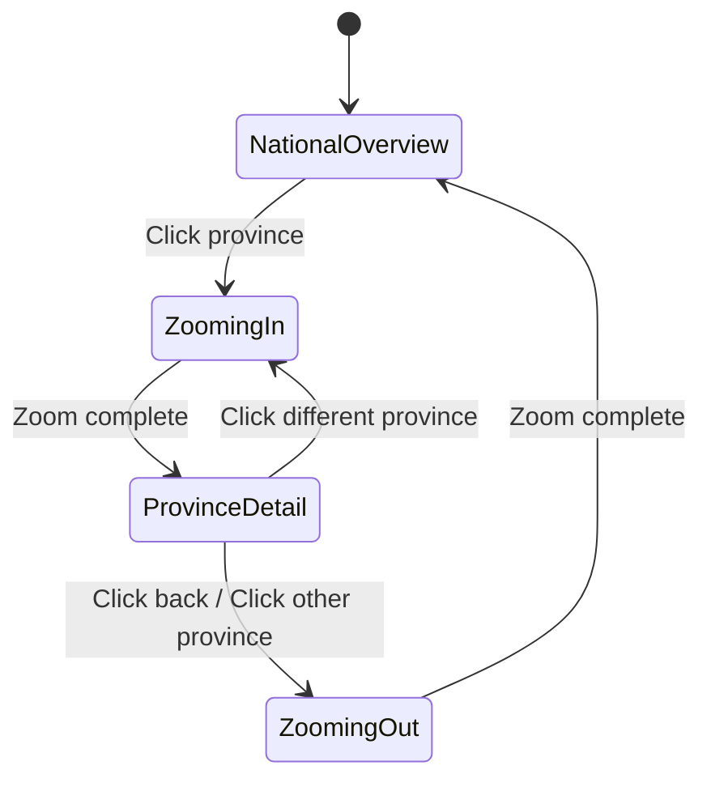

# 05 — Animation System

> Tea Atlas: Interactive Chinese Tea Culture Digital Museum
>
> **Single Source of Truth for ALL Motion Behavior**

---

## 1. Document Information

| Field | Value |
|---|---|
| **Document ID** | ANIM-005 |
| **Version** | 1.0 |
| **Status** | Draft |
| **Last Updated** | 2026-07-04 |
| **Related Documents** | `04-ui-design-system.md`, `03-site-architecture.md`, `06-map-system.md`, `13-animation-timeline.md` |

---

## 2. Architecture Principle

### 2.1 Motion as a Language System

Tea Atlas treats motion as a **language**, not a collection of effects. Every animation is expressed through a deterministic chain:

```
Interaction → Motion Mapping → ANIM-ID → Motion Definition → Execution
```

No component may bypass this chain. No ad-hoc GSAP calls exist in the codebase.

### 2.2 Separation of Concerns

```
UI Layer (04-ui-design-system.md)
    │
    │  References ANIM-IDs only
    │  Never calls GSAP directly
    │  Never defines durations, easings, or curves
    │
    ▼
Animation Layer (this document)
    │
    │  Defines all motion behavior
    │  Owns GSAP, ScrollTrigger, Lenis
    │  Knows nothing about components or pages
    │
    ▼
Execution Layer (animation/engine.ts)
    │
    │  Registers timelines
    │  Manages lifecycle (mount/unmount)
    │  Handles reduced-motion fallback
    │  Enforces frame budget
```

---

## 3. Motion Primitive System

### 3.1 Primitive Vocabulary

All animations in Tea Atlas are composed from exactly **10 motion primitives**. No animation may use a motion type outside this vocabulary.

| ID | Primitive | Definition | Parameters |
|---|---|---|---|
| `MP-01` | **Fade** | Opacity transition from value A to value B | `from`, `to`, `duration`, `easing` |
| `MP-02` | **Drift** | Continuous slow translation, often infinite loop | `direction` (x/y), `distance`, `duration`, `loop` |
| `MP-03` | **Bloom** | Scale + opacity reveal from a focal point | `origin`, `scaleFrom`, `scaleTo`, `duration`, `easing` |
| `MP-04` | **Ink Spread** | Irregular reveal simulating ink bleeding on paper | `origin`, `radius`, `duration`, `spreadPattern` |
| `MP-05` | **Float** | Gentle oscillation along Y axis | `amplitude`, `frequency`, `loop` |
| `MP-06` | **Ripple** | Radial scale + opacity pulse, single or cascading | `origin`, `radius`, `duration`, `cascadeCount` |
| `MP-07` | **Reveal** | Clip-path or mask-based content reveal | `direction`, `from`, `to`, `duration`, `easing` |
| `MP-08` | **Zoom** | Scale transformation with focal point | `from`, `to`, `origin`, `duration`, `easing` |
| `MP-09` | **Pan** | Translation across X/Y with defined path | `path` (x1,y1 → x2,y2), `duration`, `easing` |
| `MP-10` | **Stagger** | Sequenced application of another primitive to N targets | `primitive` (MP-ID), `targets`, `staggerDelay`, `direction` |

### 3.2 Primitive Composition Rules

| ID | Rule | Priority |
|---|---|---|
| MS-R01 | Every ANIM-ID must decompose into one or more motion primitives | P0 |
| MS-R02 | A composite animation uses Stagger (MP-10) or parallel execution — no new primitive for combinations | P0 |
| MS-R03 | Primitive parameters are configurable per instance; the primitive vocabulary is closed | P0 |
| MS-R04 | New primitives require a documented reason and architectural review | P0 |

---

## 4. Easing System

### 4.1 Easing Presets

All Tea Atlas animations use one of these easing presets. No custom cubic-bezier() calls outside this file.

| ID | Name | Curve | Character | Usage |
|---|---|---|---|---|
| `EASE-01` | **Ink Slow** | `cubic-bezier(0.25, 0.1, 0.1, 1.0)` | Slow deceleration, like ink settling | Hero reveals, title fades |
| `EASE-02` | **Tea Float** | `cubic-bezier(0.45, 0, 0.55, 1)` | Symmetric, gentle, floating | Hover states, fog drift, float loops |
| `EASE-03` | **Brush Stroke** | `cubic-bezier(0.33, 0, 0.67, 1)` | Balanced, deliberate | Page transitions, panel enter/exit |
| `EASE-04` | **Mist Clear** | `cubic-bezier(0.65, 0, 0.35, 1)` | Slow start, subtle end | Scene transitions, fog opacity |
| `EASE-05` | **Camera Zoom** | `cubic-bezier(0.4, 0, 0.2, 1)` | Weighted toward end | Map zoom in/out |
| `EASE-06` | **Tea Leaf Drop** | `cubic-bezier(0.22, 0.61, 0.36, 1)` | Slight bounce at end | Falling leaf, pin drop |
| `EASE-07` | **Snap** | `cubic-bezier(0.2, 0, 0, 1)` | Quick response, no overshoot | Button press, chip toggle |
| `EASE-08` | **Bloom Out** | `cubic-bezier(0, 0, 0.2, 1)` | Starts from zero, blooms outward | Card enter, bloom reveal |

### 4.2 Duration Scale

| ID | Duration (ms) | Usage |
|---|---|---|
| `DUR-01` | 150 | Micro-interactions: hover, press, toggle |
| `DUR-02` | 300 | Small transitions: chip toggle, badge appear |
| `DUR-03` | 500 | Medium transitions: card enter, panel slide |
| `DUR-04` | 800 | Page transitions: route enter/exit |
| `DUR-05` | 1200 | Major reveals: hero title, province zoom |
| `DUR-06` | 2000 | Hero landscape reveal |
| `DUR-07` | Variable (scrub) | Scroll-driven: scene transitions, timeline scrub |
| `DUR-08` | Infinite (loop) | Ambient: fog drift, float |

---

## 5. ANIM-ID Catalog

### 5.1 ID Allocation Table

| Range | Category | Count |
|---|---|---|
| ANIM-001 – ANIM-019 | Micro-interactions & UI | 19 |
| ANIM-020 – ANIM-039 | Hero & Entrance | 20 |
| ANIM-040 – ANIM-059 | Scroll Narrative & Scenes | 20 |
| ANIM-060 – ANIM-079 | Map & Camera | 20 |
| ANIM-080 – ANIM-099 | Timeline (Tea Growth) | 20 |
| ANIM-100 – ANIM-119 | Page Transitions | 20 |
| ANIM-120 – ANIM-139 | Ambient & Continuous | 20 |

### 5.2 Complete ANIM-ID Catalog

#### 5.2.1 Micro-interactions & UI (ANIM-001 – ANIM-019)

| ANIM-ID | Name | Primitive(s) | Duration | Easing | Trigger | Description |
|---|---|---|---|---|---|---|
| **ANIM-001** | Card Hover Enter | Fade + Bloom | DUR-01 | EASE-02 | Mouse enter | Card scales to 1.02, shadow elevates, 150ms |
| **ANIM-002** | Card Hover Exit | Fade + Bloom | DUR-01 | EASE-02 | Mouse leave | Card returns to 1.0, shadow resets, 150ms |
| **ANIM-003** | Button Press | Fade | DUR-01 | EASE-07 | Mouse down | Button scales to 0.97, background darkens |
| **ANIM-004** | Button Release | Fade + Bloom | DUR-01 | EASE-07 | Mouse up | Button returns to 1.0 |
| **ANIM-005** | Chip Toggle On | Fade | DUR-02 | EASE-07 | Click (inactive→active) | Chip background fades to active color |
| **ANIM-006** | Chip Toggle Off | Fade | DUR-02 | EASE-07 | Click (active→inactive) | Chip background fades to default |
| **ANIM-007** | Filter Result Enter | Stagger(Fade + Bloom) | DUR-03 | EASE-08 | Filter applied | Cards stagger-enter with 60ms delay |
| **ANIM-008** | Filter Result Exit | Stagger(Fade) | DUR-02 | EASE-03 | Filter applied | Removed cards fade out with 40ms stagger |
| **ANIM-009** | Focus Ring Appear | Fade | DUR-01 | EASE-01 | Element focused | Focus ring fades in at 2px offset |
| **ANIM-010** | Panel Open | Reveal + Fade | DUR-04 | EASE-03 | Click / route change | Panel slides in from edge + fades |
| **ANIM-011** | Panel Close | Reveal + Fade | DUR-03 | EASE-03 | Click / back navigation | Panel slides out + fades |
| **ANIM-012** | Tooltip Enter | Fade + Float | DUR-02 | EASE-02 | Hover (province) | Tooltip fades in + floats up 4px |
| **ANIM-013** | Tooltip Exit | Fade | DUR-01 | EASE-02 | Hover end | Tooltip fades out |
| **ANIM-014** | Empty State Appear | Fade + Bloom | DUR-04 | EASE-08 | No filter results | Empty state illustration fades and blooms in |
| **ANIM-015** | Scroll Indicator Pulse | Fade + Float | DUR-08 | EASE-02 | Hero animation complete | Continuous gentle bounce, loops indefinitely |
| **ANIM-016** | Nav Bar Appear | Fade + Reveal | DUR-03 | EASE-03 | Scroll past hero | Nav bar fades + slides down |
| **ANIM-017** | Nav Bar Hide | Fade | DUR-02 | EASE-03 | Scroll back to hero | Nav bar fades out |
| **ANIM-018** | Skeleton Pulse | Fade | DUR-08 | EASE-02 | Component loading | Opacity oscillates 0.4 ↔ 0.7, loops |
| **ANIM-019** | Scroll-to-Top | Pan | DUR-04 | EASE-05 | Click scroll-to-top | Smooth scroll to top via Lenis |

#### 5.2.2 Hero & Entrance (ANIM-020 – ANIM-039)

| ANIM-ID | Name | Primitive(s) | Duration | Easing | Trigger | Description |
|---|---|---|---|---|---|---|
| **ANIM-020** | Hero Landscape Reveal | Ink Spread + Fade | DUR-06 | EASE-01 | Page load | Ink-wash mountains emerge from white, mist clears |
| **ANIM-021** | Hero Fog Layer 1 Drift | Drift | DUR-08 | — | Page load (loop) | Distant fog drifts slowly left, infinite |
| **ANIM-022** | Hero Fog Layer 2 Drift | Drift | DUR-08 | — | Page load (loop) | Foreground fog drifts right (faster), infinite |
| **ANIM-023** | Tea Leaf Fall | Float + Fade | DUR-05 | EASE-06 | Hero landscape complete | Single tea leaf descends with sway, lands center |
| **ANIM-024** | Title Reveal | Fade + Reveal | DUR-04 | EASE-01 | Tea leaf landed | "Tea Atlas" fades in with ink-spread reveal |
| **ANIM-025** | Subtitle Reveal | Fade | DUR-03 | EASE-01 | Title complete | Subtitle fades in below title |
| **ANIM-026** | Scroll Indicator Reveal | Fade + Float | DUR-03 | EASE-08 | Subtitle complete | Scroll-down indicator appears |
| **ANIM-027** | Hero Skip (scroll) | Fade | DUR-03 | EASE-03 | User scroll during hero | All hero elements fade out; scroll narrative begins |
| **ANIM-028** | Hero Return Skip | — | 0 | — | Return visit (same session) | Hero animation skipped; static frame shown, then fades to scenes |
| **ANIM-029** | Hero Parallax Mountains | Drift | DUR-07 | — | Scroll (0–15%) | Mountain layers parallax at different rates |
| **ANIM-030** | Hero Fog Exit | Fade | DUR-07 | EASE-04 | Scroll (0–15%) | Fog opacity decreases as user scrolls into scenes |

#### 5.2.3 Scroll Narrative & Scenes (ANIM-040 – ANIM-059)

| ANIM-ID | Name | Primitive(s) | Duration | Easing | Trigger | Description |
|---|---|---|---|---|---|---|
| **ANIM-040** | Scene Background Crossfade | Fade | DUR-07 | EASE-04 | Scroll position (scene boundary) | Previous scene background fades out, new fades in |
| **ANIM-041** | Scene Text Enter | Fade + Reveal | DUR-07 | EASE-01 | Scroll position (scene start) | Scene title and body text fades in + reveals from bottom |
| **ANIM-042** | Scene Text Exit | Fade | DUR-07 | EASE-04 | Scroll position (scene end) | Scene text fades out |
| **ANIM-043** | Scene Parallax Midground | Drift | DUR-07 | — | Scroll position (scene active) | Midground elements move at 0.5× scroll speed |
| **ANIM-044** | Scene Parallax Foreground | Drift | DUR-07 | — | Scroll position (scene active) | Foreground elements move at 1.2× scroll speed |
| **ANIM-045** | Scene Ink Element Reveal | Ink Spread | DUR-07 | EASE-01 | Scroll position (scene start) | Ink-wash illustration elements bleed in |
| **ANIM-046** | Scene Tea Element Float | Float | DUR-08 | EASE-02 | Scene active (loop) | Tea leaves/flowers float gently within scene |
| **ANIM-047** | Scene Transition Trigger | Fade | DUR-07 | EASE-04 | Defined scroll trigger point | Orchestrates scene entry + previous scene exit |
| **ANIM-048** | Scroll Narrative End | Fade | DUR-03 | EASE-03 | Scroll past last scene | All scene elements fade; map section begins |

#### 5.2.4 Map & Camera (ANIM-060 – ANIM-079)

| ANIM-ID | Name | Primitive(s) | Duration | Easing | Trigger | Description |
|---|---|---|---|---|---|---|
| **ANIM-060** | Map Section Enter | Fade | DUR-07 | EASE-04 | Scroll into map section | Map fades in as scroll narrative ends |
| **ANIM-061** | Province Hover Glow | Fade | DUR-01 | EASE-02 | Mouse enter province | Province fill lightens, subtle glow |
| **ANIM-062** | Province Hover Exit | Fade | DUR-01 | EASE-02 | Mouse leave province | Province fill returns to default |
| **ANIM-063** | Camera Zoom In (Province) | Zoom + Pan | DUR-05 | EASE-05 | Click province | Camera zooms from national overview to province detail |
| **ANIM-064** | Camera Zoom Out (National) | Zoom + Pan | DUR-04 | EASE-05 | Click "Back to China" | Camera zooms out to national overview |
| **ANIM-065** | Province Pin Drop | Float + Fade | DUR-05 | EASE-06 | Zoom in complete | Tea point pins drop onto province one by one (stagger 100ms) |
| **ANIM-066** | Province Label Reveal | Fade + Reveal | DUR-03 | EASE-01 | Zoom in complete | Province name label fades in |
| **ANIM-067** | Province Detail Panel Enter | Reveal + Fade | DUR-04 | EASE-03 | Zoom in complete | Detail panel slides in from right |
| **ANIM-068** | Province Detail Panel Exit | Reveal + Fade | DUR-03 | EASE-03 | Zoom out start | Detail panel slides out |
| **ANIM-069** | Map Fog Drift | Drift | DUR-08 | — | Map visible (loop) | Fog layer over map drifts slowly |
| **ANIM-070** | Map Terrain Parallax | Drift | DUR-07 | — | Scroll in map section | Terrain texture shifts with scroll |
| **ANIM-071** | Map Scroll-to-Zoom | Zoom | DUR-07 | EASE-05 | Scroll wheel in map section | Optional: zoom map with scroll wheel (P1) |
| **ANIM-072** | Map Reset View | Zoom + Pan | DUR-03 | EASE-03 | Click reset button | Smooth return to default national view |

#### 5.2.5 Timeline — Tea Growth (ANIM-080 – ANIM-099)

| ANIM-ID | Name | Primitive(s) | Duration | Easing | Trigger | Description |
|---|---|---|---|---|---|---|
| **ANIM-080** | Timeline Section Enter | Fade | DUR-07 | EASE-04 | Scroll into timeline section | Timeline section fades in |
| **ANIM-081** | Timeline Stage Advance | Fade + Bloom | DUR-07 | — | Horizontal scroll (scrub) | Stage illustration blooms as horizontal scroll progresses |
| **ANIM-082** | Timeline Stage Indicator | Fade + Reveal | DUR-07 | — | Horizontal scroll (scrub) | Stage dot fills + label fades in when stage reached |
| **ANIM-083** | Timeline Stage Complete | Fade | DUR-02 | EASE-03 | Stage fully scrubbed | Stage dot shows check, label dims slightly |
| **ANIM-084** | Timeline Progress Line | Reveal | DUR-07 | — | Horizontal scroll (scrub) | Connecting line draws between stages |
| **ANIM-085** | Timeline Stage Illustration | Ink Spread | DUR-07 | — | Stage active (scrub) | Ink-wash illustration of each stage bleeds in |
| **ANIM-086** | Timeline Tea Leaf Particles | Drift + Float | DUR-08 | EASE-02 | Timeline active (loop) | Small tea leaves float around timeline |
| **ANIM-087** | Timeline Section Exit | Fade | DUR-07 | EASE-04 | Scroll past timeline | Timeline fades out |

#### 5.2.6 Page Transitions (ANIM-100 – ANIM-119)

| ANIM-ID | Name | Primitive(s) | Duration | Easing | Trigger | Description |
|---|---|---|---|---|---|---|
| **ANIM-100** | Page Enter (Default) | Fade + Reveal | DUR-04 | EASE-03 | Route change (enter) | New page fades up 20px + fades in |
| **ANIM-101** | Page Exit (Default) | Fade | DUR-03 | EASE-03 | Route change (exit) | Old page fades out |
| **ANIM-102** | Page Enter (Map) | Fade + Bloom | DUR-04 | EASE-08 | Navigate to /map | Map blooms from center |
| **ANIM-103** | Page Exit (Map) | Fade | DUR-03 | EASE-03 | Navigate from /map | Map fades out |
| **ANIM-104** | Page Enter (Encyclopedia) | Fade | DUR-04 | EASE-01 | Navigate to /encyclopedia | Content fades in |
| **ANIM-105** | Page Enter (Tea Detail) | Fade + Reveal | DUR-04 | EASE-03 | Navigate to /tea/:slug | Detail page slides up 30px + fades |
| **ANIM-106** | Page Enter (Province Detail) | Fade + Reveal | DUR-04 | EASE-03 | Navigate to /province/:slug | Detail page slides up 30px + fades |
| **ANIM-107** | Page Exit (Detail) | Fade | DUR-03 | EASE-03 | Navigate back from detail | Detail page fades out |
| **ANIM-108** | Shared Element Transition | Zoom + Fade | DUR-04 | EASE-05 | Card click → detail page | Tea card image morphs to detail hero (P1 — future) |

#### 5.2.7 Ambient & Continuous (ANIM-120 – ANIM-139)

| ANIM-ID | Name | Primitive(s) | Duration | Easing | Trigger | Description |
|---|---|---|---|---|---|---|
| **ANIM-120** | Global Fog Drift | Drift | DUR-08 | — | App loaded (loop) | Global fog layer drifts continuously, very slow |
| **ANIM-121** | Paper Texture Parallax | Drift | DUR-07 | — | Scroll (global) | Paper texture shifts at 0.05× scroll speed |
| **ANIM-122** | Ink Wash Background Drift | Drift | DUR-08 | — | App loaded (loop) | Subtle ink wash movement on page backgrounds |
| **ANIM-123** | Tea Leaf Particle System | Float + Drift | DUR-08 | EASE-02 | Scene/timeline active (loop) | Ambient tea leaf particles float in certain sections |
| **ANIM-124** | Cursor Trail | Fade + Float | DUR-08 | EASE-02 | Mouse move (P2) | Optional ink-brush cursor trail (deferred) |
| **ANIM-125** | Page Idle Micro-motion | Drift | DUR-08 | — | Page visible (loop) | Extremely subtle background shift (~2px over 20s) |

---

## 6. Interaction → Motion Mapping

### 6.1 Complete Mapping Table

Every user interaction maps to exactly one ANIM-ID. No interaction exists without a motion mapping.

| Interaction | Trigger | ANIM-ID | Category |
|---|---|---|---|
| Card hover enter | Mouse enter | ANIM-001 | UI |
| Card hover exit | Mouse leave | ANIM-002 | UI |
| Button press | Mouse down | ANIM-003 | UI |
| Button release | Mouse up | ANIM-004 | UI |
| Chip toggle on | Click (inactive → active) | ANIM-005 | UI |
| Chip toggle off | Click (active → inactive) | ANIM-006 | UI |
| Filter apply (cards enter) | Filter changed | ANIM-007 | UI |
| Filter apply (cards exit) | Filter changed | ANIM-008 | UI |
| Element focus | Tab / click | ANIM-009 | UI |
| Panel open | Click / route | ANIM-010 | UI |
| Panel close | Click / back | ANIM-011 | UI |
| Tooltip show | Hover (province) | ANIM-012 | UI |
| Tooltip hide | Hover end | ANIM-013 | UI |
| Empty state appear | No results | ANIM-014 | UI |
| Scroll indicator pulse | Hero complete | ANIM-015 | UI |
| Nav bar appear | Scroll past hero | ANIM-016 | UI |
| Nav bar hide | Scroll to hero | ANIM-017 | UI |
| Skeleton loading | Component mount | ANIM-018 | UI |
| Scroll to top | Click button | ANIM-019 | UI |
| Page load (hero) | Window load | ANIM-020 – ANIM-026 | Hero |
| Hero skip | Scroll during hero | ANIM-027 | Hero |
| Return visit | Same-session revisit | ANIM-028 | Hero |
| Scroll 0–15% | Scroll position | ANIM-029, ANIM-030 | Hero |
| Scene enter (any) | Scroll position (trigger) | ANIM-047 | Scenes |
| Scene background change | Scroll position | ANIM-040 | Scenes |
| Scene text enter | Scroll position | ANIM-041 | Scenes |
| Scene text exit | Scroll position | ANIM-042 | Scenes |
| Scene parallax | Scroll position | ANIM-043, ANIM-044 | Scenes |
| Scene ink reveal | Scroll position | ANIM-045 | Scenes |
| Scene tea float | Scene active | ANIM-046 | Scenes |
| Narrative end | Scroll past scenes | ANIM-048 | Scenes |
| Map section enter | Scroll position | ANIM-060 | Map |
| Province hover | Mouse enter province | ANIM-061 | Map |
| Province unhover | Mouse leave province | ANIM-062 | Map |
| Click province | Click | ANIM-063 | Map |
| Click back (national) | Click button | ANIM-064 | Map |
| Province pins drop | Zoom complete | ANIM-065 | Map |
| Province label reveal | Zoom complete | ANIM-066 | Map |
| Detail panel enter | Zoom complete | ANIM-067 | Map |
| Detail panel exit | Zoom out start | ANIM-068 | Map |
| Map fog | Map visible | ANIM-069 | Map |
| Map terrain parallax | Scroll position | ANIM-070 | Map |
| Map scroll zoom | Scroll wheel | ANIM-071 | Map |
| Map reset | Click reset | ANIM-072 | Map |
| Timeline enter | Scroll position | ANIM-080 | Timeline |
| Stage advance | Horizontal scroll | ANIM-081 | Timeline |
| Stage indicator | Horizontal scroll | ANIM-082 | Timeline |
| Stage complete | Stage end reached | ANIM-083 | Timeline |
| Progress line | Horizontal scroll | ANIM-084 | Timeline |
| Stage illustration | Horizontal scroll | ANIM-085 | Timeline |
| Timeline particles | Timeline active | ANIM-086 | Timeline |
| Timeline exit | Scroll past | ANIM-087 | Timeline |
| Page enter (default) | Route change | ANIM-100 | Transition |
| Page exit (default) | Route change | ANIM-101 | Transition |
| Page enter (map) | Navigate to /map | ANIM-102 | Transition |
| Page exit (map) | Navigate from /map | ANIM-103 | Transition |
| Page enter (encyclopedia) | Navigate to /encyclopedia | ANIM-104 | Transition |
| Page enter (tea detail) | Navigate to /tea/:slug | ANIM-105 | Transition |
| Page enter (province) | Navigate to /province/:slug | ANIM-106 | Transition |
| Page exit (detail) | Navigate back | ANIM-107 | Transition |
| Shared element | Card → detail | ANIM-108 | Transition |
| Ambient fog | App loaded | ANIM-120 | Ambient |
| Paper texture shift | Scroll | ANIM-121 | Ambient |
| Ink wash drift | App loaded | ANIM-122 | Ambient |
| Tea particles | Scene/timeline | ANIM-123 | Ambient |
| Cursor trail | Mouse move | ANIM-124 | Ambient |
| Idle micro-motion | Page visible | ANIM-125 | Ambient |

---

## 7. Scroll System

### 7.1 Scroll Architecture

| Component | Responsibility | Technology |
|---|---|---|
| **Scroll Controller** | Normalize scroll input; provide scroll position as single source of truth | Lenis |
| **ScrollTrigger Registry** | Map scroll positions to animation triggers | GSAP ScrollTrigger |
| **Parallax Controller** | Manage multi-layer parallax ratios | Custom hook + GSAP |
| **Scene Trigger System** | Define scene start/end scroll points; activate scene animations | `animation/scene-triggers.ts` |

### 7.2 Scroll-Driven Animation Rules

| ID | Rule | Priority |
|---|---|---|
| SCR-R01 | All scroll position values come from Lenis, never from `window.scrollY` | P0 |
| SCR-R02 | Scene triggers are defined as percentage ranges (0%–100% of total scrollable height), not pixel values | P0 |
| SCR-R03 | Scroll-driven animations (scrub) have a 1:1 relationship with scroll position — no independent timelines | P0 |
| SCR-R04 | Parallax ratios are: Background 0.3×, Midground 0.6×, Foreground 1.0×, Overlay 1.3× | P0 |
| SCR-R05 | Horizontal scroll sections (timeline) use `pin` + `horizontal: true` in ScrollTrigger | P0 |
| SCR-R06 | Scrolljack only within defined scroll-driven sections; native scroll elsewhere | P0 |
| SCR-R07 | Lenis `lerp` value: 0.08 (subtle smoothing, not floaty) | P0 |

### 7.3 Scene Scroll Mapping

| Scene | Scroll Range (%) | Trigger Point | Exit Point |
|---|---|---|---|
| Hero | 0% – 15% | 0% | 15% |
| Scene 1: Ancient Forests | 15% – 28% | 15% | 28% |
| Scene 2: Tea Mountains | 28% – 42% | 28% | 42% |
| Scene 3: Harvest | 42% – 56% | 42% | 56% |
| Scene 4: Processing | 56% – 70% | 56% | 70% |
| Scene 5: Tea Ceremony | 70% – 84% | 70% | 84% |
| Scene 6: Modern Appreciation | 84% – 95% | 84% | 95% |
| Map Section (embedded) | 95% – 120% | 95% | 120% |
| Timeline Section | 120% – 150% | 120% | 150% |
| Footer / End | 150% – 160% | 150% | 160% |

> Percentages are approximate and will be calibrated during implementation. Total scrollable height ≈ 8–10 viewport heights.

---

## 8. Camera System

### 8.1 Camera State Machine

The map camera has exactly 3 states:



### 8.2 Camera Parameters

| Parameter | National Overview | Province Detail |
|---|---|---|
| Scale | 1.0 (default) | 2.5 – 3.5 (varies by province size) |
| Center X | 50% (China center) | Province centroid |
| Center Y | 50% (China center) | Province centroid |
| Transition Duration | — | DUR-05 (1200ms) |
| Easing | — | EASE-05 |
| Fog Opacity | 0.35 | 0.10 (less fog when zoomed) |
| Non-tea Provinces | Visible (muted) | Hidden or heavily muted |

### 8.3 Camera Rules

| ID | Rule | Priority |
|---|---|---|
| CAM-R01 | Camera state changes are always animated — no jump cuts | P0 |
| CAM-R02 | During camera transition, all map interactions are disabled | P0 |
| CAM-R03 | Camera zoom uses `transform-origin` at the clicked province centroid | P0 |
| CAM-R04 | Camera state is stored in `CameraContext` — not in component state | P0 |
| CAM-R05 | Zoom level clamping: min 1.0, max 4.0 | P0 |

---

## 9. Transition System

### 9.1 Page Transition Lifecycle

```
Route Change Trigger
    │
    ├── 1. Exit Animation (current page)
    │       ANIM-101 (default exit: fade out, 300ms)
    │       or ANIM-103, ANIM-107 (page-specific exit)
    │
    ├── 2. Wait for exit to complete
    │       (or overlap by 100ms for crossfade feel)
    │
    ├── 3. Mount new page component
    │
    └── 4. Enter Animation (new page)
            ANIM-100 (default enter: fade up, 800ms)
            or ANIM-102, ANIM-104, ANIM-105, ANIM-106 (page-specific enter)
```

### 9.2 Transition Rules

| ID | Rule | Priority |
|---|---|---|
| TRN-R01 | All route changes trigger exit + enter animations | P0 |
| TRN-R02 | Exit and enter overlap by 100ms for continuity | P0 |
| TRN-R03 | During transition, no user interaction is accepted (prevents double-navigate) | P0 |
| TRN-R04 | Browser back/forward triggers the same transition as link click | P0 |
| TRN-R05 | Scroll position is restored after back-navigation to list pages | P0 |
| TRN-R06 | Transition duration totals ≤ 1200ms (exit 300ms + overlap 100ms + enter 800ms) | P0 |

---

## 10. Performance Constraints

### 10.1 Frame Budget

| Constraint | Target |
|---|---|
| Animation frame rate | 60fps (16.67ms per frame) |
| JS execution per frame | ≤ 8ms (leaves 8ms for style/layout/paint) |
| Active GSAP tweens (max concurrent) | ≤ 30 |
| Active ScrollTrigger instances (max concurrent) | ≤ 20 |
| SVG nodes animated simultaneously | ≤ 200 |

### 10.2 Performance Rules

| ID | Rule | Priority |
|---|---|---|
| PRF-R01 | Animate only `transform` and `opacity` where possible — avoid `width`, `height`, `top`, `left` | P0 |
| PRF-R02 | Use `will-change` on elements that animate, but remove after animation completes | P0 |
| PRF-R03 | Fog and particle effects use CSS animations on `transform` (GPU-composited), not canvas (unless proven necessary) | P0 |
| PRF-R04 | ScrollTrigger `scrub` animations use `scrub: true` (not numeric) for 1:1 scroll binding | P0 |
| PRF-R05 | GSAP `.kill()` is called on all timelines when component unmounts | P0 |
| PRF-R06 | Lenis is destroyed on app unmount — no scroll listener leaks | P0 |
| PRF-R07 | All GSAP animations use `gsap.context()` for grouped cleanup | P0 |
| PRF-R08 | `prefers-reduced-motion` disables all non-essential animations; essential transitions downgrade to instant fades | P0 |

### 10.3 Reduced Motion Fallback

| Condition | Behavior |
|---|---|
| `prefers-reduced-motion: reduce` | All scrubbed animations → instant; all timed animations → fade only (DUR-01); no parallax; no drift; no float |
| Low FPS detected (< 30fps sustained) | Disable fog particles; reduce parallax layers to 2; reduce concurrent tweens to 15 |

---

## 11. Implementation Architecture

### 11.1 File Ownership (in `animation/`)

| File | Content | ANIM-IDs Covered |
|---|---|---|
| `engine.ts` | GSAP init, ScrollTrigger register, Lenis singleton, reduced-motion check, `gsap.context()` factory | — |
| `primitives.ts` | All 10 motion primitives as reusable functions | MP-01 – MP-10 |
| `easing.ts` | Easing presets + duration constants | EASE-01 – EASE-08, DUR-01 – DUR-08 |
| `presets.ts` | Reusable animation presets composed from primitives | ANIM-001 – ANIM-019 (micro-interactions) |
| `hero-timeline.ts` | Hero entrance animation timeline | ANIM-020 – ANIM-030 |
| `scene-triggers.ts` | Scroll scene trigger definitions + scene animations | ANIM-040 – ANIM-048 |
| `map-animations.ts` | Camera zoom, pan, province interactions | ANIM-060 – ANIM-072 |
| `timeline-scrub.ts` | Horizontal scroll scrub for tea growth timeline | ANIM-080 – ANIM-087 |
| `transitions.ts` | Page transition enter/exit animations | ANIM-100 – ANIM-108 |
| `ambient.ts` | Continuous ambient effects (fog, drift, particles) | ANIM-120 – ANIM-125 |
| `scroll-controller.ts` | Lenis setup, scroll normalization, scene position calculation | — |

### 11.2 Component Integration Pattern

Components interact with the Animation System through exactly one pattern:

```
1. Component imports animation trigger function from animation/
2. Component passes a ref (or selector) to the trigger function
3. Component passes the ANIM-ID to request the specific animation
4. Animation system handles everything else
```

No component file contains:
- `gsap.to()` / `gsap.from()` / `gsap.timeline()`
- `ScrollTrigger.create()`
- Raw `requestAnimationFrame()`
- CSS `@keyframes` for interactive animations (CSS-only ambient effects are allowed in `styles/animations.css`)

---

## 12. Risks

| ID | Risk | Impact | Likelihood | Mitigation |
|---|---|---|---|---|
| RISK-AN-01 | GSAP + React lifecycle mismatch causes memory leaks | High | Medium | Strict cleanup via `gsap.context()`; automated leak detection test |
| RISK-AN-02 | ScrollTrigger pinning causes layout shifts on resize | Medium | Medium | `ScrollTrigger.refresh()` on resize; debounced 200ms |
| RISK-AN-03 | 60+ ANIM-IDs may be too many to maintain | Medium | Low | IDs grouped by category; most are thin wrappers around primitives |
| RISK-AN-04 | Horizontal scroll (timeline) conflicts with Lenis vertical scroll | Medium | Medium | Lenis configured to ignore horizontal scroll within pinned section |
| RISK-AN-05 | Fog drift animation consumes GPU memory over long sessions | Low | Low | CSS `transform` only; no canvas; GPU memory is bounded |
| RISK-AN-06 | Reduced motion fallback not tested across all animations | Medium | Medium | Include reduced-motion test in every animation task AC |

---

## 13. Constraints

| ID | Constraint |
|---|---|
| AN-C01 | All animation code lives in `animation/` directory — zero exceptions |
| AN-C02 | Components reference only ANIM-IDs — never import GSAP directly |
| AN-C03 | All animations decompose to primitives from Section 3 |
| AN-C04 | No custom easing curves outside `animation/easing.ts` |
| AN-C05 | Maximum 30 concurrent GSAP tweens at any moment |
| AN-C06 | Maximum 20 active ScrollTrigger instances |
| AN-C07 | All timelines killed on unmount — verified by automated check |
| AN-C08 | `prefers-reduced-motion` checked once at engine init; all animations downgrade |
| AN-C09 | No animation exceeds DUR-06 (2000ms) for timed animations |
| AN-C10 | Scroll-driven animations use scrub — no independent scroll-linked timelines |

---

## 14. Acceptance Criteria

- [ ] All 10 motion primitives defined with parameter signatures
- [ ] 8 easing presets defined with named curves
- [ ] 8 duration constants defined
- [ ] Complete ANIM-ID catalog: 60+ IDs across 7 categories
- [ ] Every ANIM-ID maps to one or more motion primitives
- [ ] Every ANIM-ID specifies: trigger, duration, easing, primitive composition
- [ ] Interaction → Motion mapping table covers all user interactions
- [ ] Scroll system architecture defined (Lenis + ScrollTrigger + parallax ratios)
- [ ] Scene scroll mapping table with percentage ranges
- [ ] Camera state machine (3 states) with parameters
- [ ] Page transition lifecycle (4 steps) with overlap specification
- [ ] Performance constraints: frame budget, max tweens, max ScrollTriggers
- [ ] Reduced motion fallback behavior specified
- [ ] All AN-C* constraints are verifiable
- [ ] No animation definition overlaps with `04-ui-design-system.md`
- [ ] Component integration pattern documented (ref + ANIM-ID only)

---

## 15. Open Questions

| ID | Question | Impact | Resolution Needed By |
|---|---|---|---|
| AN-Q01 | Should the hero animation auto-play on every page load, or only on first visit per session? | User experience for return visits | Before Task: Hero |
| AN-Q02 | Should province zoom use a smooth scale transform or a two-step (scale then pan) animation? | Visual quality vs complexity | Before Task: Map Camera |
| AN-Q03 | Should the timeline horizontal scroll use native scroll or GSAP `containerAnimation`? | Cross-browser behavior | Before Task: Timeline |
| AN-Q04 | Should page transitions use a shared layout element or full-page crossfade? | Visual continuity vs implementation complexity | Before Task: Page Transitions |
| AN-Q05 | Should the fog layer use CSS `background-position` animation or a canvas shader? | 60fps target on low-end devices | Before Task: Ambient Effects |
| AN-Q06 | What is the fallback behavior on devices that can't sustain 60fps? | Performance tier system | Before Task: Animation Engine |

---

## 16. References

| Document | Relationship |
|---|---|
| `03-site-architecture.md` | Defines animation directory structure and module ownership |
| `04-ui-design-system.md` | Section 15 (Motion References) maps UI interactions to ANIM-IDs defined here |
| `06-map-system.md` | Map camera behavior is defined here; map data structure is defined there |
| `13-animation-timeline.md` | Frame-by-frame sequencing of all animations in temporal order |

---

## 17. Implementation Checklist

- [ ] AN-001: `animation/engine.ts` — GSAP + ScrollTrigger + Lenis init
- [ ] AN-002: `animation/easing.ts` — all easing presets + duration constants
- [ ] AN-003: `animation/primitives.ts` — all 10 motion primitives
- [ ] AN-004: `animation/presets.ts` — ANIM-001 through ANIM-019
- [ ] AN-005: `animation/hero-timeline.ts` — ANIM-020 through ANIM-030
- [ ] AN-006: `animation/scene-triggers.ts` — ANIM-040 through ANIM-048
- [ ] AN-007: `animation/map-animations.ts` — ANIM-060 through ANIM-072
- [ ] AN-008: `animation/timeline-scrub.ts` — ANIM-080 through ANIM-087
- [ ] AN-009: `animation/transitions.ts` — ANIM-100 through ANIM-108
- [ ] AN-010: `animation/ambient.ts` — ANIM-120 through ANIM-125
- [ ] AN-011: `animation/scroll-controller.ts` — Lenis + scene position calc
- [ ] AN-012: Reduced motion fallback implemented and tested
- [ ] AN-013: Frame budget monitoring tool added (dev mode)
- [ ] AN-014: All GSAP cleanup verified (no leaks on route change)

---

## 18. Next Document

> **`06-map-system.md`** — SVG China map architecture, province GeoJSON/SVG data, camera state machine implementation, province interaction model, tea point positioning, and map layer composition.

---

> This document is the motion constitution of Tea Atlas. Every animation — from a 150ms hover to a 2000ms hero reveal — is defined here. Components and pages reference ANIM-IDs. They never define motion. This separation guarantees that Codex can safely generate UI without inventing animation logic, and that all motion can be tuned from a single source of truth.
