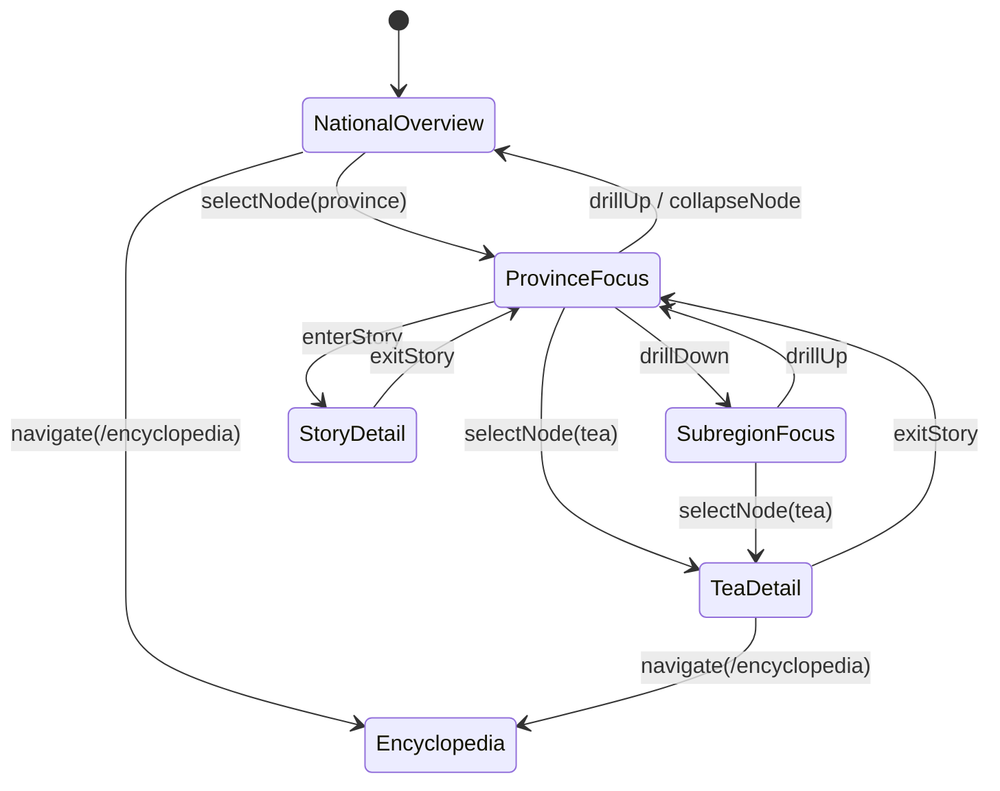
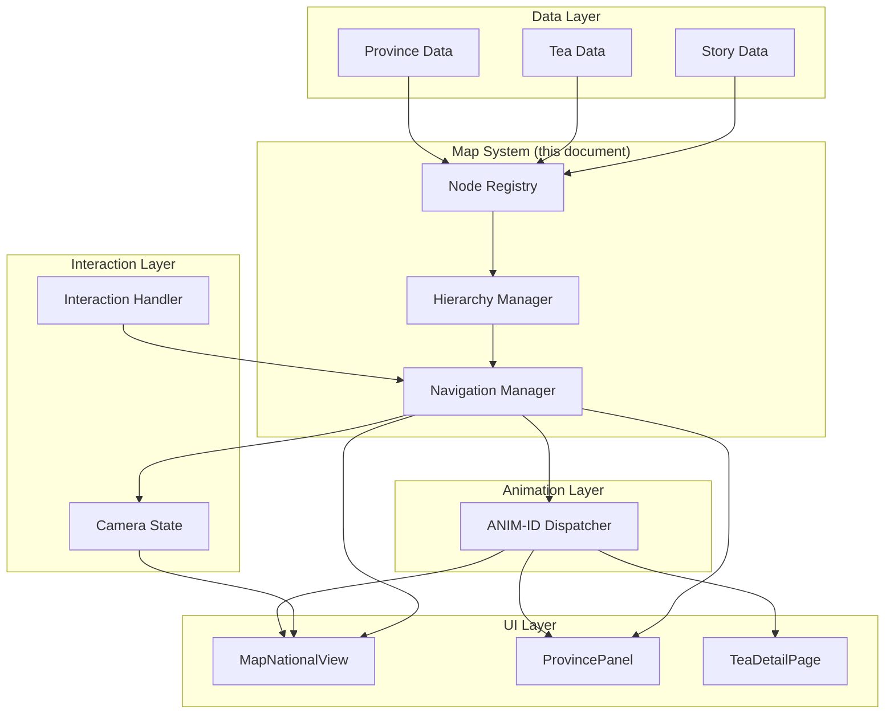

# 06 — Map System

> Tea Atlas: Interactive Chinese Tea Culture Digital Museum
>
> **Single Source of Truth for Information Topology & Navigation Logic**

---

## 1. Document Information

| Field | Value |
|---|---|
| **Document ID** | MAP-006 |
| **Version** | 1.0 |
| **Status** | Draft |
| **Last Updated** | 2026-07-04 |
| **Related Documents** | `02-information-architecture.md`, `03-site-architecture.md`, `04-ui-design-system.md`, `05-animation-system.md`, `07-tea-content-system.md` |

---

## 2. Core Principle

### 2.1 Map = Information Operating System

The Tea Atlas map is not a geographic visualization. It is an **information operating system** — a structural layer that defines:

- How content nodes are organized
- How nodes relate to each other
- How users traverse the knowledge graph
- How UI and animation layers react to navigation events

The map itself is invisible to the user. What users see (SVG China map, province highlights, zoom transitions) is the **UI projection** of this system. The Map System owns the logic underneath.

### 2.2 Separation Mandate

```
Map System (this document)
    │
    │  Defines:     Nodes, Relationships, Navigation Logic, Interaction Flow
    │  References:  UI Component Types, ANIM-IDs
    │  Never:       Layout, Styling, Animation Code, DOM, GSAP, z-index
    │
    ├──► UI System (04-ui-design-system.md)
    │         Projects nodes into visual components
    │
    └──► Animation System (05-animation-system.md)
              Executes motion when navigation events fire
```

---

## 3. Node System

### 3.1 Node Schema

Every content entity in Tea Atlas is modeled as a node. All nodes share a common schema.

| Field | Type | Required | Description |
|---|---|---|---|
| `id` | `string` | Yes | Globally unique node identifier |
| `type` | `NodeType` | Yes | Node category (see 3.2) |
| `metadata` | `NodeMetadata` | Yes | Display name, description, tags |
| `relations` | `NodeRelations` | Yes | Parent, children, related nodes |
| `entryBehavior` | `ANIM-ID` | Yes | Animation triggered when node becomes active |
| `exitBehavior` | `ANIM-ID` | Yes | Animation triggered when node becomes inactive |
| `uiComponent` | `ComponentRef` | Yes | UI component that renders this node |

### 3.2 Node Types

| Type | Description | Example | UI Component | Priority |
|---|---|---|---|---|
| `country` | Root node — China | China | `MapNationalView` | P0 |
| `region` | Major tea-growing region | Jiangnan (江南) | `RegionGroup` | P0 |
| `province` | Administrative province | Fujian, Yunnan, Zhejiang | `ProvinceNode`, `ProvincePanel` | P0 |
| `subregion` | Sub-province tea area | Wuyi Mountains, Xishuangbanna | `SubRegionPin` | P1 |
| `tea` | A specific tea variety | Longjing, Tieguanyin, Pu'er | `TeaCard`, `TeaDetailPage` | P0 |
| `story` | Cultural narrative node | Tea Horse Road, Shennong Legend | `StoryPanel` | P1 |
| `culture` | Cultural practice or artifact | Gongfu Tea Ceremony, Yixing Teapot | `CultureCard` | P1 |
| `timeline` | Historical event node | Tang Dynasty tea culture | `TimelineNode` | P1 |

### 3.3 Node Metadata

| Field | Type | Required | Description |
|---|---|---|---|
| `name` | `string` | Yes | Display name (English) |
| `nameZh` | `string` | No | Display name (Chinese characters) |
| `description` | `string` | Yes | Short description (1–2 sentences) |
| `tags` | `string[]` | Yes | Searchable tags |
| `icon` | `string` | No | Icon reference from icon inventory (Section 14, 04) |

### 3.4 Node Relations

| Field | Type | Required | Description |
|---|---|---|---|
| `parent` | `string \| null` | Yes | Parent node ID; `null` for root node |
| `children` | `string[]` | Yes | Child node IDs; empty array for leaf nodes |
| `related` | `string[]` | No | Related node IDs (non-hierarchical, cross-cutting) |
| `geoCenter` | `{x: number, y: number}` | No | Geographic center for map positioning (province, subregion, tea nodes) |
| `geoBounds` | `{minX, minY, maxX, maxY}` | No | Geographic bounding box for zoom calculation |

---

## 4. Node Hierarchy

### 4.1 Hierarchy Tree

```
Country (China)                          ← Root
├── Region: Jiangnan (江南)              ← Tea region group
│   ├── Province: Zhejiang
│   │   ├── Subregion: West Lake
│   │   │   └── Tea: Longjing (龙井)
│   │   ├── Tea: Anji Baicha (安吉白茶)
│   │   └── Culture: Hangzhou Tea Ceremony
│   ├── Province: Jiangsu
│   │   └── Tea: Biluochun (碧螺春)
│   └── Province: Anhui
│       ├── Tea: Keemun (祁门红茶)
│       ├── Tea: Huangshan Maofeng (黄山毛峰)
│       └── Tea: Taiping Houkui (太平猴魁)
│
├── Region: South China (华南)
│   ├── Province: Fujian
│   │   ├── Subregion: Wuyi Mountains
│   │   │   ├── Tea: Da Hong Pao (大红袍)
│   │   │   └── Tea: Tieguanyin (铁观音)
│   │   ├── Tea: Lapsang Souchong (正山小种)
│   │   ├── Tea: Bai Hao Yinzhen (白毫银针)
│   │   └── Culture: Gongfu Tea Ceremony
│   └── Province: Guangdong
│       └── Tea: Fenghuang Dancong (凤凰单丛)
│
├── Region: Southwest (西南)
│   ├── Province: Yunnan
│   │   ├── Subregion: Xishuangbanna
│   │   │   └── Tea: Pu'er Sheng (普洱生茶)
│   │   ├── Tea: Pu'er Shou (普洱熟茶)
│   │   ├── Tea: Dian Hong (滇红)
│   │   └── Story: Tea Horse Road (茶马古道)
│   ├── Province: Sichuan
│   │   └── Tea: Mengding Ganlu (蒙顶甘露)
│   └── Province: Guizhou
│       └── Tea: Duyun Maojian (都匀毛尖)
│
└── Region: Jiangbei (江北)
    ├── Province: Henan
    │   └── Tea: Xinyang Maojian (信阳毛尖)
    └── Province: Shandong
        └── Tea: Laoshan Green (崂山绿茶)
```

### 4.2 Hierarchy Rules

| ID | Rule | Priority |
|---|---|---|
| MAP-R01 | Every node (except root) has exactly one parent in the hierarchy | P0 |
| MAP-R02 | `related` edges are non-hierarchical — they do not affect parent/child traversal | P0 |
| MAP-R03 | Hierarchy depth: max 5 levels (Country → Region → Province → Subregion → Tea) | P0 |
| MAP-R04 | No circular parent-child relationships | P0 |
| MAP-R05 | Leaf nodes (tea, story, culture) have no children | P0 |
| MAP-R06 | A `related` edge is bidirectional — if A relates to B, B relates to A | P0 |

---

## 5. Navigation Model

### 5.1 Navigation as Graph Traversal

User navigation is not page-based. It is a **graph traversal** over the node hierarchy. Every navigation action is one of these atomic operations:

| Operation | Definition | Triggers ANIM-ID | Example |
|---|---|---|---|
| `selectNode` | Make a node the active focus | Node's `entryBehavior` | Click province → province becomes active |
| `focusNode` | Center viewport on a node without selecting it | ANIM-061 (hover glow) | Hover province |
| `expandNode` | Reveal a node's children | ANIM-063 (zoom in) | Click province → show subregions and teas |
| `collapseNode` | Hide a node's children; return to parent | ANIM-064 (zoom out) | Click "Back to China" |
| `enterStory` | Navigate into a story/culture node detail | ANIM-067 (panel enter) | Click "Tea Horse Road" story |
| `exitStory` | Return from story to parent node | ANIM-068 (panel exit) | Close story panel |
| `zoomToNode` | Animate camera to a specific node's geoCenter | ANIM-063 (zoom in) or ANIM-064 (zoom out) | Click tea point → zoom to subregion |
| `drillDown` | Descend one hierarchy level | ANIM-063 | National → Province |
| `drillUp` | Ascend one hierarchy level | ANIM-064 | Province → National |

### 5.2 Navigation State Machine



### 5.3 Navigation Rules

| ID | Rule | Priority |
|---|---|---|
| NAV-R01 | Only one node is `active` (selected) at a time | P0 |
| NAV-R02 | Multiple nodes may be `focused` (hovered) — only on hover, not persisted | P0 |
| NAV-R03 | Navigation state changes always trigger an animation via ANIM-ID | P0 |
| NAV-R04 | During animation (camera transition), all navigation inputs are ignored | P0 |
| NAV-R05 | Browser back button reverses the last navigation operation | P0 |
| NAV-R06 | Direct URL navigation (`/province/fujian`) sets the corresponding node as active on load | P0 |
| NAV-R07 | Navigation between sibling provinces does not return to NationalOverview first | P1 |

---

## 6. Camera System

### 6.1 Camera States

The camera has 4 zoom levels, each corresponding to a hierarchy depth:

| Camera State | Hierarchy Level | Scale Range | Visible Nodes | Active Interaction |
|---|---|---|---|---|
| **Global View** | Country | 1.0 | Country, Region labels | Hover regions, click to zoom |
| **Region View** | Region / Province cluster | 1.5 – 2.0 | Multiple provinces in region | Hover provinces, click to select |
| **Province View** | Province | 2.5 – 3.5 | Single province, subregions, tea pins | Click tea pins, click back |
| **Detail View** | Subregion / Tea | 3.5 – 4.0 | Subregion + individual tea locations | Click tea → detail page |

### 6.2 Camera Parameters per Province

| Province | `geoCenter` (SVG coords) | Zoom Scale | Fog Opacity |
|---|---|---|---|
| Yunnan | (32, 68) | 3.2 | 0.10 |
| Fujian | (68, 62) | 3.0 | 0.10 |
| Zhejiang | (72, 48) | 3.5 | 0.10 |
| Anhui | (66, 44) | 3.2 | 0.10 |
| Sichuan | (38, 52) | 2.8 | 0.10 |
| Hunan | (55, 55) | 3.0 | 0.10 |
| Guangdong | (60, 70) | 3.0 | 0.10 |
| Henan | (58, 38) | 3.2 | 0.10 |
| Guizhou | (46, 60) | 3.0 | 0.10 |
| Jiangsu | (74, 42) | 3.5 | 0.10 |

> Coordinates are expressed as percentages of SVG viewBox (0–100 on each axis). Values are placeholders; actual values depend on the SVG map asset.

### 6.3 Camera Rules

| ID | Rule | Priority |
|---|---|---|
| CAM-R01 | Camera transitions always animate — no jump cuts between zoom levels | P0 |
| CAM-R02 | `transform-origin` is set to the target province's `geoCenter` before zoom | P0 |
| CAM-R03 | Zoom scale is clamped: min 1.0, max 4.0 | P0 |
| CAM-R04 | Fog opacity decreases as zoom increases (less fog = more detail visible) | P0 |
| CAM-R05 | Non-active provinces fade to `Opacity.Muted` (0.6) during province view | P0 |
| CAM-R06 | Non-tea provinces use `Opacity.Muted` (0.4) in all views | P0 |

---

## 7. Interaction Model

### 7.1 Interaction Flow

Every map interaction follows this exact chain:

```
User Action
    │
    ▼
Interaction Handler (Map Module)
    │  Identifies: target node, operation type
    │
    ▼
Node State Change
    │  Updates: active node, camera state, visible children
    │
    ▼
ANIM-ID Trigger
    │  Dispatches to Animation System (05)
    │
    ▼
UI Update
    │  Re-renders affected components with new state
    │
    ▼
Animation Complete
    │  Interaction re-enabled
```

### 7.2 Interaction Table

| User Action | Operation | Target Node | Pre-condition | Post-condition | ANIM-ID |
|---|---|---|---|---|---|
| Hover province | `focusNode` | Province | National view | Province glows | ANIM-061 |
| Hover end | `focusNode` (clear) | Province | Province hovered | Glow removed | ANIM-062 |
| Click province | `selectNode` + `expandNode` | Province | National view | Province view | ANIM-063 |
| Click "Back to China" | `collapseNode` | Country | Province view | National view | ANIM-064 |
| Click tea pin | `selectNode` | Tea | Province view | Tea detail page | ANIM-063 → ANIM-105 |
| Click subregion label | `drillDown` | Subregion | Province view | Subregion detail | ANIM-063 |
| Click related story | `enterStory` | Story | Province view | Story panel open | ANIM-067 |
| Close story panel | `exitStory` | Province | Story open | Province view | ANIM-068 |
| Click different province | `selectNode` (new) | Province | Province view (other) | New province view | ANIM-064 → ANIM-063 |
| Scroll wheel | `zoomToNode` | Current active | Any | Zoom adjust | ANIM-071 |
| Click reset | `collapseNode` (to root) | Country | Any | National view | ANIM-072 |

---

## 8. Node → ANIM-ID Mapping

| Node Type | `entryBehavior` (ANIM-ID) | `exitBehavior` (ANIM-ID) |
|---|---|---|
| `country` | ANIM-060 (Map section enter) | ANIM-040 (Scene crossfade out) |
| `region` | ANIM-061 (Hover glow) | ANIM-062 (Glow exit) |
| `province` | ANIM-063 (Zoom in) + ANIM-067 (Panel enter) | ANIM-064 (Zoom out) + ANIM-068 (Panel exit) |
| `subregion` | ANIM-063 (Zoom in) | ANIM-064 (Zoom out) |
| `tea` | ANIM-065 (Pin drop) + ANIM-105 (Page enter) | ANIM-107 (Page exit) |
| `story` | ANIM-067 (Panel enter) | ANIM-068 (Panel exit) |
| `culture` | ANIM-067 (Panel enter) | ANIM-068 (Panel exit) |

---

## 9. Node → UI Component Mapping

| Node Type | UI Component (from `04-ui-design-system.md`) | Component Token |
|---|---|---|
| `country` | `MapNationalView` | `Map.Background` |
| `region` | `RegionGroup` (label overlay) | `Panel.Floating` |
| `province` | `ProvinceNode` (SVG path) + `ProvincePanel` (detail) | `Panel.Floating` |
| `subregion` | `SubRegionPin` (marker + label) | — |
| `tea` | `TeaCard` (encyclopedia) / `TeaDetailPage` (full page) | `Card.Default` |
| `story` | `StoryPanel` | `Panel.Detail` |
| `culture` | `CultureCard` | `Card.Default` |

---

## 10. Data Flow Architecture

### 10.1 Data Pipeline



### 10.2 Data Flow Rules

| ID | Rule | Priority |
|---|---|---|
| DFL-R01 | Data flows one direction: Data → Node Registry → Navigation → Animation → UI | P0 |
| DFL-R02 | UI never reads data directly — it receives pre-processed node state from Navigation Manager | P0 |
| DFL-R03 | Animation layer receives only ANIM-ID + target ref — never node data | P0 |

---

## 11. Province Data Requirements

### 11.1 Required SVG Map Asset

The China SVG map must include the following data per province path element:

| Attribute | Required | Description |
|---|---|---|
| `id` or `data-province` | Yes | Province identifier matching node `id` |
| `d` (path data) | Yes | Province boundary path |
| `data-is-tea-region` | Yes | `"true"` or `"false"` |
| `data-centroid-x` | Yes | Province center X (percentage 0–100) |
| `data-centroid-y` | Yes | Province center Y (percentage 0–100) |
| `data-bounds` | No | Bounding box for zoom calculation |

### 11.2 Tea Pin Data

Each tea node requires positioning relative to its parent province:

| Field | Required | Description |
|---|---|---|
| `pinX` | Yes | Pin X position within province (percentage 0–100) |
| `pinY` | Yes | Pin Y position within province (percentage 0–100) |
| `labelOffset` | No | Tooltip offset direction (`"top"`, `"bottom"`, `"left"`, `"right"`) |

---

## 12. Non-Tea Provinces

Provinces that are not tea-producing regions are included on the map but in a muted state.

| Province | Status | Visual Treatment |
|---|---|---|
| Xinjiang | Non-tea | `Opacity.Muted` (0.4), no hover, not clickable |
| Tibet | Non-tea | `Opacity.Muted` (0.4), no hover, not clickable |
| Inner Mongolia | Non-tea | `Opacity.Muted` (0.4), no hover, not clickable |
| Gansu | Non-tea | `Opacity.Muted` (0.4), no hover, not clickable |
| Ningxia | Non-tea | `Opacity.Muted` (0.4), no hover, not clickable |
| Qinghai | Non-tea | `Opacity.Muted` (0.4), no hover, not clickable |
| Heilongjiang | Non-tea | `Opacity.Muted` (0.4), no hover, not clickable |
| Jilin | Non-tea | `Opacity.Muted` (0.4), no hover, not clickable |
| Liaoning | Non-tea | `Opacity.Muted` (0.4), no hover, not clickable |
| Hebei | Non-tea | `Opacity.Muted` (0.4), no hover, not clickable |
| Shanxi | Non-tea | `Opacity.Muted` (0.4), no hover, not clickable |
| Shaanxi | Non-tea | `Opacity.Muted` (0.4), no hover, not clickable |
| Hainan | Non-tea | `Opacity.Muted` (0.4), no hover, not clickable |
| Tianjin | Non-tea | `Opacity.Muted` (0.4), no hover, not clickable |
| Beijing | Non-tea | `Opacity.Muted` (0.4), no hover, not clickable |
| Shanghai | Non-tea | `Opacity.Muted` (0.4), no hover, not clickable |
| Chongqing | Non-tea | `Opacity.Muted` (0.4), no hover, not clickable |

---

## 13. Map Layer Composition

### 13.1 Visual Layers (on top of Map Data)

Layers stack from bottom to top. These reference the layer system in `04-ui-design-system.md` (Section 13).

| z-index | Layer | Content | Animated By |
|---|---|---|---|
| 60 | Map Base | SVG China map paths (all provinces) | — |
| 60 | Map Terrain | Ink-wash terrain texture overlay | ANIM-070 |
| 60 | Map Fog | Atmospheric fog overlay | ANIM-069 |
| 70 | Province Labels | Active province name labels | ANIM-066 |
| 70 | Tea Pins | Tea point markers on zoomed province | ANIM-065 |
| 70 | Subregion Labels | Subregion text labels (zoom ≥ 3.0) | — |
| 100 | Detail Panel | Floating panel on province click | ANIM-067, ANIM-068 |

### 13.2 Layer Rules

| ID | Rule | Priority |
|---|---|---|
| LYR-R01 | Map layers use z-index from 04-ui-design-system.md (Section 13) — no ad-hoc values | P0 |
| LYR-R02 | Tea pins are only visible when their parent province is the active node (zoom ≥ 2.5) | P0 |
| LYR-R03 | Subregion labels are only visible at zoom ≥ 3.0 | P0 |
| LYR-R04 | Detail panel replaces (does not overlay) province labels when open | P0 |

---

## 14. Map Module Implementation Architecture

### 14.1 File Ownership (in `modules/map/`)

| File | Responsibility |
|---|---|
| `node-registry.ts` | Builds and maintains the node graph from data files |
| `hierarchy-manager.ts` | Parent/child traversal, node lookup, relationship queries |
| `navigation-manager.ts` | Active node state, navigation operation dispatch, history stack |
| `camera-state.ts` | Current zoom level, camera position, transition state |
| `interaction-handler.ts` | Translates user events into navigation operations |
| `province-data.ts` | Province node definitions (imports from `data/provinces.ts`) |
| `tea-pin-data.ts` | Tea pin positions and node references |
| `map-svg.tsx` | SVG map React component (renders paths, handles events) |
| `province-panel.tsx` | Province detail panel component |
| `tea-pin.tsx` | Individual tea pin marker component |

### 14.2 Integration Points

| Map Module File | Imports From | Exports To |
|---|---|---|
| `node-registry.ts` | `data/provinces.ts`, `data/teas.ts` | `hierarchy-manager.ts` |
| `hierarchy-manager.ts` | `node-registry.ts` | `navigation-manager.ts`, UI components |
| `navigation-manager.ts` | `hierarchy-manager.ts` | `interaction-handler.ts`, `contexts/map-context.ts` |
| `camera-state.ts` | `navigation-manager.ts` | `animation/map-animations.ts` |
| `interaction-handler.ts` | `navigation-manager.ts` | `map-svg.tsx` |
| `map-svg.tsx` | `interaction-handler.ts`, `animation/map-animations.ts` | Pages (`Homepage`, `MapPage`) |

---

## 15. Risks

| ID | Risk | Impact | Likelihood | Mitigation |
|---|---|---|---|---|
| RISK-MAP-01 | SVG China map with 30+ province paths exceeds 3000 DOM nodes | Medium | Medium | Path simplification; non-tea provinces use simplified paths |
| RISK-MAP-02 | Province centroid data does not match SVG viewBox, causing off-center zooms | High | Medium | Validate all centroids against actual SVG path bounds; automated test |
| RISK-MAP-03 | User clicks province during camera transition, causing state conflict | Medium | Medium | Interaction disabled during animation; queue last interaction |
| RISK-MAP-04 | Non-tea provinces visually indistinguishable from tea provinces | Low | Low | Use `Opacity.Muted` (0.4) + gray fill; clear visual difference |
| RISK-MAP-05 | Node hierarchy depth (5 levels) is too complex for casual navigation | Low | Low | Navigation bar provides shortcuts; encyclopedia bypasses hierarchy entirely |
| RISK-MAP-06 | Tea pin clutter when province has > 5 teas | Medium | Low | Group nearby pins into clusters at zoom < 3.5; expand on further zoom |

---

## 16. Constraints

| ID | Constraint |
|---|---|
| MAP-C01 | SVG map DOM nodes ≤ 3000 (including all province paths, labels, pins) |
| MAP-C02 | Node hierarchy max depth: 5 levels |
| MAP-C03 | Max concurrent active nodes: 1 (selected) + 1 (hovered) |
| MAP-C04 | No animation code in `modules/map/` — all motion dispatched via ANIM-ID |
| MAP-C05 | No DOM manipulation in node logic files — only in React components |
| MAP-C06 | Node IDs are stable strings — never change after v1 launch |
| MAP-C07 | Province `geoCenter` values are validated against actual SVG path bounds |
| MAP-C08 | Non-tea provinces are not interactive — no hover, no click, no label |
| MAP-C09 | Camera zoom transitions are queued — a new zoom request during animation waits for completion |

---

## 17. Acceptance Criteria

- [ ] Node schema defined with 8 required fields
- [ ] 8 node types defined with UI component and ANIM-ID mappings
- [ ] Complete node hierarchy tree covering all provinces, teas, stories
- [ ] 9 atomic navigation operations defined
- [ ] Navigation state machine diagram covers all valid transitions
- [ ] Camera states defined for 4 zoom levels with scale ranges
- [ ] Province camera parameters table (geoCenter, zoom, fog) for all 10 tea provinces
- [ ] Interaction table maps all 10 user actions to operations and ANIM-IDs
- [ ] Node → ANIM-ID mapping complete for all node types
- [ ] Node → UI Component mapping complete for all node types
- [ ] Data flow diagram shows unidirectional pipeline
- [ ] SVG asset requirements specified (province path attributes)
- [ ] Non-tea province list (17 provinces) with muted treatment
- [ ] Map layer composition aligned with 04-ui-design-system.md z-index system
- [ ] Map module file ownership defined (11 files)
- [ ] All MAP-C* constraints are verifiable

---

## 18. Open Questions

| ID | Question | Impact | Resolution Needed By |
|---|---|---|---|
| MAP-Q01 | Should the SVG map be a single inline SVG file, or separate province SVGs composed at runtime? | Bundle size vs flexibility | Before Task: Map Module |
| MAP-Q02 | Should tea pins cluster at lower zoom levels? | UI clarity for provinces with many teas | Before Task: Tea Pins |
| MAP-Q03 | Should the map support free pan (drag to pan), or only click-to-zoom? | Interaction complexity | Before Task: Map Interaction |
| MAP-Q04 | Should non-tea provinces be completely hidden in Province View, or just heavily muted? | Visual clarity | Before Task: Camera System |
| MAP-Q05 | Should the embedded homepage map share the same node registry instance as the `/map` page? | State consistency vs memory | Before Task: Map Module Architecture |

---

## 19. References

| Document | Relationship |
|---|---|
| `01-product-requirements.md` | FR-M-01 – FR-M-10 define map functional requirements |
| `02-information-architecture.md` | Section 5.2 defines map page zones and content |
| `03-site-architecture.md` | Map module directory structure and component ownership |
| `04-ui-design-system.md` | Layer system (z-index), panel variants, badge variants, icon inventory |
| `05-animation-system.md` | All ANIM-* IDs referenced here are defined there |
| `07-tea-content-system.md` | Tea and province data that populates node registry |

---

## 20. Implementation Checklist

- [ ] MAP-001: `node-registry.ts` — builds node graph from data files
- [ ] MAP-002: `hierarchy-manager.ts` — parent/child/related traversal
- [ ] MAP-003: `navigation-manager.ts` — active node, history stack, operation dispatch
- [ ] MAP-004: `camera-state.ts` — zoom level, position, transition lock
- [ ] MAP-005: `interaction-handler.ts` — event → operation translation
- [ ] MAP-006: `province-data.ts` — province node definitions
- [ ] MAP-007: `tea-pin-data.ts` — tea pin positions
- [ ] MAP-008: `map-svg.tsx` — SVG renderer with event handlers
- [ ] MAP-009: `province-panel.tsx` — detail panel component
- [ ] MAP-010: `tea-pin.tsx` — pin marker component
- [ ] MAP-011: SVG China map asset acquired/created with required `data-*` attributes
- [ ] MAP-012: Province centroids validated against SVG paths
- [ ] MAP-013: Non-tea provinces correctly muted and non-interactive
- [ ] MAP-014: Camera zoom in/out with ANIM-063/ANIM-064 integration
- [ ] MAP-015: Browser back button reverses navigation correctly

---

## 21. Next Document

> **`07-tea-content-system.md`** — Tea data schema, content types, flavor profile structure, brewing guide format, province content model, story/culture content model, and content authoring rules.

---

> This document is the structural operating system of Tea Atlas. Every piece of content is a node. Every navigation action is a graph traversal. Every interaction flows through a single pipeline: User Action → Node Change → ANIM-ID → UI Update. The SVG map that users see is a projection of this system — not the system itself.
