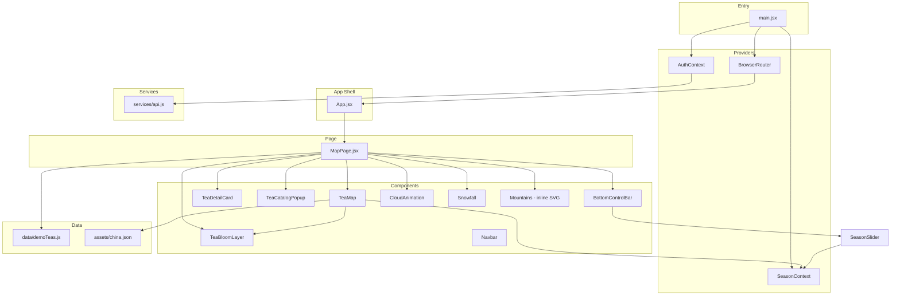

# 09 — Frontend Architecture

> Tea Atlas: Interactive Chinese Tea Culture Digital Museum
>
> **Description of How the System IS Organized — Not a Redesign**

---

## 1. Document Information

| Field | Value |
|---|---|
| **Document ID** | FA-009 |
| **Version** | 1.0 |
| **Status** | Draft |
| **Last Updated** | 2026-07-04 |
| **Related Documents** | `03-site-architecture.md`, `08-component-specification.md`, `07-tea-content-system.md`, `10-development-roadmap.md` |

---

## 2. Architecture Principle

> **This document describes the ACTUAL frontend architecture as it exists in `Desktop/tea/client/`. It does not propose a new ideal architecture. Adjustments are limited to minimal recommendations that do not break existing code.**

---

## 3. Project Overview

### 3.1 Tech Stack (Actual)

| Layer | Technology | Version | Usage in Code |
|---|---|---|---|
| Framework | React | 18.3.1 | All components |
| Build | Vite | 6.0.1 | Dev server + build |
| Routing | React Router | 6.28.0 | `App.jsx` route definitions |
| Styling | Tailwind CSS | 3.4.15 | All component className |
| Map | D3 (d3-geo) | 7.9.0 | TeaMap projection, zoom, GeoJSON rendering |
| 3D Effects | Three.js | 0.185.1 | TeaBloomLayer (WebGL canvas) |
| UI Animation | framer-motion | 11.11.1 | TeaDetailCard, TeaCatalogPopup enter/exit |
| Scroll Animation | GSAP + ScrollTrigger | (in animations/) | Not currently imported by UI components |
| HTTP | axios | 1.7.7 | `services/api.js` |
| Notifications | react-hot-toast | 2.4.1 | Toaster in `main.jsx` |
| Charts | echarts | 5.5.1 | **Unused** — dependency present, no component imports |

### 3.2 Project Root

```
tea/
├── client/           ← Frontend (this document)
├── server/           ← Backend (out of scope for this document)
│   └── ...           (Express API: auth, teas, favorites, checkins, admin)
```

---

## 4. Current Folder Structure

### 4.1 Full Tree (Actual)

```
client/
├── index.html
├── package.json
├── vite.config.js
├── tailwind.config.js
├── postcss.config.js
│
├── public/
│   └── (static files, if any)
│
├── dist/                          ← Vite build output (gitignored)
│
└── src/
    ├── main.jsx                   ← Entry: ReactDOM.createRoot, providers, router
    ├── App.jsx                    ← Route definitions (/, /map, *)
    ├── index.css                  ← Global styles + CSS custom properties
    │
    ├── animations/                ← GSAP timeline definitions
    │   ├── heroTimeline.ts
    │   ├── mapTimeline.ts
    │   ├── provinceZoom.ts
    │   └── scrollTimeline.ts
    │
    ├── assets/                    ← Static assets
    │   ├── china.json             ← GeoJSON (TopoJSON/GeoJSON) for China map
    │   └── generated/             ← Pre-rendered map images
    │       ├── tea-map-clean-base-hd.png   ← Main map artwork
    │       ├── tea-map-clean-base.jpg
    │       ├── tea-map-soft.png
    │       ├── tea-map-wide.png
    │       ├── tea-map-portrait.png
    │       ├── ink-bloom-china-map.jpg
    │       └── ink-bloom-china-reference.jpg
    │
    ├── components/                ← UI components (feature-grouped)
    │   ├── Effects/               ← Ambient visual effects
    │   │   ├── CloudAnimation.jsx
    │   │   ├── FallingPetals.jsx
    │   │   └── Snowfall.jsx
    │   ├── Map/                   ← Map-related components
    │   │   ├── TeaMap.jsx         ← Main interactive map
    │   │   ├── TeaDetailCard.jsx  ← Tea detail slide-in panel
    │   │   └── TeaBloomLayer.jsx  ← Three.js bloom overlay
    │   ├── Navigation/            ← Navigation controls
    │   │   ├── Navbar.jsx         ← Top nav bar
    │   │   └── BottomControlBar.jsx ← Bottom toolbar
    │   ├── Tea/                   ← Tea catalog
    │   │   └── TeaCatalogPopup.jsx ← Category filter + tea list
    │   └── UI/                    ← Generic UI primitives
    │       └── SeasonSlider.jsx   ← Season selector slider
    │
    ├── contexts/                  ← React Context providers
    │   ├── AuthContext.jsx        ← Auth state (user, login, logout, isAdmin)
    │   └── SeasonContext.jsx      ← Season state + SEASONS constant + normalizeSeasonText()
    │
    ├── data/                      ← Static data
    │   └── demoTeas.js            ← 27-tea array (single source of truth for UI)
    │
    ├── pages/                     ← Page-level components
    │   └── MapPage.jsx            ← Main page: map + panels + effects
    │
    ├── services/                  ← API layer
    │   └── api.js                 ← axios instance + authAPI, teaAPI, favAPI, checkinAPI, adminAPI
    │
    ├── hooks/                     ← Custom hooks (EMPTY — no files)
    ├── styles/                    ← Additional stylesheets (EMPTY — no files)
    ├── types/                     ← TypeScript type definitions (EMPTY — no files)
    ├── utils/                     ← Utility functions (EMPTY — no files)
    └── layouts/                   ← Layout components (EMPTY — no files)
```

### 4.2 Empty Directories

| Directory | Intended Purpose | Current Status |
|---|---|---|
| `hooks/` | Custom React hooks | Empty — no custom hooks extracted |
| `styles/` | Additional CSS files | Empty — all styles in `index.css` + Tailwind |
| `types/` | TypeScript type definitions | Empty — project is JS/JSX, no types |
| `utils/` | Pure utility functions | Empty — utilities are inline or in contexts |
| `layouts/` | Layout wrapper components | Empty — App.jsx handles layout directly |

### 4.3 Recommendation (Minimal)

| Action | Rationale |
|---|---|
| Keep all empty directories | They signal intended architecture; prevents ad-hoc file placement |
| Do NOT create new top-level directories | Current structure is sufficient for v1 |
| Extract `normalizeSeasonText()` and `getMonths()` to `utils/` | Currently duplicated across components |
| Extract `spotsFor()` to `utils/` | Currently inline in TeaDetailCard |

---

## 5. Module Boundaries

### 5.1 Module Dependency Map



### 5.2 Import Rules (Actual)

| Rule | Description | Enforced By |
|---|---|---|
| `pages/` imports from `components/`, `contexts/`, `data/` | Page composes components + data | Convention |
| `components/` imports from `contexts/`, `data/` | Components consume context + data | Convention |
| `components/Map/` does NOT import from `components/Tea/` | Map and Tea are sibling feature groups | Current code follows this |
| `contexts/` imports from `services/` (AuthContext only) | Auth context wraps API calls | Current code |
| `data/` imports NOTHING | Leaf module — pure data export | Current code |
| No component imports from `pages/` | Pages are top-level; nothing above them | Convention |
| `animations/` is NOT imported by any component | GSAP timelines are standalone scripts | Current code |

---

## 6. Data Flow

### 6.1 Primary Data Path

```
demoTeas.js (static array, 27 teas)
    │
    ▼
MapPage.jsx (imports demoTeas)
    │
    ├──► TeaMap (prop: teas={demoTeas})
    │       │
    │       ├── FlowerMarker (computed: marker.x, marker.y, marker.inSeason)
    │       └── Tooltip (data: marker.name, marker.province, marker.city)
    │
    ├──► TeaDetailCard (prop: tea={selectedTea})
    │       │
    │       └── Sections: name, province, city, category, meaning, maturity_months
    │
    └──► TeaCatalogPopup (prop: teas={demoTeas})
            │
            └── Filter: category → filtered list → name, province, city, category, maturity_months
```

### 6.2 Secondary Data Paths

```
GeoJSON (/china.json)
    │
    ▼
TeaMap.jsx (fetch at runtime, module-level cache)
    │
    └── Province path rendering (d3 projection)

---

SeasonContext.jsx
    │
    ▼
TeaMap.jsx (useSeason() → season → inSeason calculation per marker)
MapPage.jsx (useSeason() → seasonalCount)

---

AuthContext.jsx
    │
    ▼
Navbar.jsx (useAuth() → user, isAdmin, logout)
    │
    └── services/api.js (axios interceptors → JWT header)

---

localStorage
    │
    ├── TeaDetailCard: tea-favorite-{id} → favorite toggle
    ├── AuthContext: token, user → auth persistence
    └── MapPage: counts favorites via Object.keys(localStorage)
```

### 6.3 Data NOT Currently Flowing

| Source | Why Not Used |
|---|---|
| `services/api.js` teaAPI | UI reads from `demoTeas.js` directly — API exists for future server-driven data |
| `services/api.js` favAPI | Favorites stored in localStorage — API exists for future server sync |
| `services/api.js` checkinAPI | No checkin UI implemented |
| `animations/*.ts` | GSAP timelines exist but are not imported — components use framer-motion instead |
| `echarts` | Package installed but never imported |

---

## 7. State Architecture

### 7.1 State Inventory (Actual)

| State | Location | Type | Scope | Persisted? |
|---|---|---|---|---|
| `season` | `SeasonContext` | Context | Global (all components) | No |
| `month` | `SeasonContext` | Context | Global | No |
| `user` | `AuthContext` | Context | Global | Yes (localStorage) |
| `isAdmin` | `AuthContext` | Context (derived) | Global | No |
| `selectedTea` | `MapPage` | `useState` | Page | No |
| `catalogOpen` | `MapPage` | `useState` | Page | No |
| `bloomOpen` | `MapPage` | `useState` | Page | No |
| `favoriteCount` | `MapPage` | `useState` | Page | Derived from localStorage |
| `geoData` | `TeaMap` | `useState` | Component | No (module-level cache) |
| `dims` | `TeaMap` | `useState` | Component | No |
| `transform` | `TeaMap` | `useState` (d3 zoom) | Component | No |
| `tooltip` | `TeaMap` | `useState` | Component | No |
| `hoveredBloomId` | `TeaMap` | `useState` | Component | No |
| `selectedBloomId` | `TeaMap` | `useState` | Component | No |
| `isFavorite` | `TeaDetailCard` | `useState` | Component | Yes (localStorage) |
| `category` (filter) | `TeaCatalogPopup` | `useState` | Component | No |
| JWT `token` | localStorage | — | Global | Yes |

### 7.2 State Ownership Rules

| ID | Rule | Priority |
|---|---|---|
| STATE-R01 | Map interaction state (`transform`, `tooltip`, `geoData`, `hoveredBloomId`, `selectedBloomId`) lives in `TeaMap` — not lifted to `MapPage` | P0 |
| STATE-R02 | UI toggle state (`catalogOpen`, `bloomOpen`, `selectedTea`) lives in `MapPage` — the page orchestrates component visibility | P0 |
| STATE-R03 | Season is global context because it affects markers, header, and effects across components | P0 |
| STATE-R04 | Auth is global context because Navbar and API interceptors both consume it | P0 |
| STATE-R05 | Favorite state is local to `TeaDetailCard` + persisted to localStorage — not synced to a global store | P0 |
| STATE-R06 | Filter state in `TeaCatalogPopup` resets on close — no persistence | P0 |
| STATE-R07 | No component reads state from another component's internal useState — all cross-component communication goes through `MapPage` props | P0 |

### 7.3 State Flow Diagram

```
SeasonContext (global)
    │
    ▼
TeaMap ← season → inSeason → marker opacity + size
MapPage ← season → seasonalCount

AuthContext (global)
    │
    ▼
Navbar ← user/isAdmin → link visibility
api.js ← token → Authorization header

MapPage (page-level)
    │
    ├── selectedTea ──► TeaDetailCard (tea prop)
    ├── catalogOpen ──► TeaCatalogPopup (isOpen prop)
    ├── bloomOpen ────► TeaMap (bloomOpen prop) → TeaBloomLayer
    └── favoriteCount  (derived, not passed down)

TeaMap (component-level)
    │
    ├── geoData ───────► province path rendering
    ├── transform ─────► SVG transform + TeaBloomLayer sync
    ├── tooltip ───────► tooltip <div>
    ├── hoveredBloomId ► TeaBloomLayer (activeId prop)
    └── selectedBloomId ► TeaBloomLayer + onTeaSelect callback
```

---

## 8. Component Registration

### 8.1 Component Rendering Tree

```
<main.jsx>
  <BrowserRouter>
    <AuthProvider>
      <SeasonProvider>
        <App>
          <Routes>
            <Route "/" | "/map">
              <MapPage>
                ├── <Mountains />              (inline SVG, static)
                ├── <CloudAnimation />         (CSS ambient)
                ├── <Header />                 (inline: brand + stats)
                ├── <TeaMap>                   (D3 + SVG)
                │     ├── <FlowerMarker /> ×27 (inline, per tea)
                │     ├── <Tooltip />          (conditional)
                │     └── <TeaBloomLayer />    (Three.js canvas)
                ├── <TeaDetailCard />          (framer-motion panel)
                ├── <Snowfall />               (particle effect)
                ├── <BottomControlBar />       (zoom + toggles)
                │     └── <SeasonSlider />     (season selector)
                └── <TeaCatalogPopup />        (framer-motion bottom sheet)
              </MapPage>
            </Route>
            <Route "*">
              <Navigate to="/map" />
            </Route>
          </Routes>
        </App>
        <Toaster />                            (react-hot-toast)
      </SeasonProvider>
    </AuthProvider>
  </BrowserRouter>
</main.jsx>
```

### 8.2 Component Import Graph

```
MapPage.jsx imports:
  ├── data/demoTeas               (default import { demoTeas })
  ├── contexts/SeasonContext       (named: useSeason, SEASONS, normalizeSeasonText)
  ├── components/Map/TeaMap        (default)
  ├── components/Map/TeaDetailCard (default)
  ├── components/Navigation/BottomControlBar (default)
  ├── components/Tea/TeaCatalogPopup (default)
  ├── components/Effects/CloudAnimation (default)
  └── components/Effects/Snowfall  (default)

TeaMap.jsx imports:
  ├── d3 (d3-zoom)
  ├── assets/generated/tea-map-clean-base-hd.png
  ├── contexts/SeasonContext       (named: useSeason, normalizeSeasonText)
  └── components/Map/TeaBloomLayer (default)

TeaDetailCard.jsx imports:
  └── framer-motion               (named: motion, AnimatePresence)

TeaCatalogPopup.jsx imports:
  └── framer-motion               (named: motion, AnimatePresence)

TeaBloomLayer.jsx imports:
  └── three                       (named: various THREE classes)

BottomControlBar.jsx imports:
  └── components/UI/SeasonSlider  (default)

Navbar.jsx imports:
  ├── react-router-dom            (named: Link, useLocation)
  └── contexts/AuthContext         (named: useAuth)

AuthContext.jsx imports:
  └── services/api                (named: authAPI)
```

---

## 9. Dependency Rules

### 9.1 Allowed Imports

| From | May Import From |
|---|---|
| `pages/` | `components/`, `contexts/`, `data/`, `hooks/`, `utils/` |
| `components/` | `contexts/`, `data/`, `hooks/`, `utils/`, `assets/` |
| `contexts/` | `services/`, `hooks/`, `utils/` |
| `services/` | `utils/` (only) |
| `data/` | Nothing |
| `hooks/` | `contexts/`, `services/`, `utils/` |
| `utils/` | Nothing (pure functions) |
| `animations/` | GSAP, `utils/`, `assets/` |

### 9.2 Forbidden Imports

| From | Must NOT Import |
|---|---|
| `components/` | `pages/` (no upward imports) |
| `data/` | Anything (must remain side-effect-free) |
| `utils/` | `components/`, `pages/`, `contexts/`, React |
| `components/Map/` | `components/Tea/` (sibling feature groups independent) |
| `components/Tea/` | `components/Map/` |

### 9.3 Dependency Rule IDs

| ID | Rule | Priority |
|---|---|---|
| DEP-R01 | `data/` is a leaf module — zero imports | P0 |
| DEP-R02 | `pages/` → `components/` only (never reverse) | P0 |
| DEP-R03 | `components/` feature groups (Map, Tea, Navigation, Effects, UI) are independent of each other | P0 |
| DEP-R04 | Cross-feature-group communication goes through `MapPage` (page lifts state up) | P0 |
| DEP-R05 | `animations/` and `components/` are independent — neither imports the other | P0 |
| DEP-R06 | No circular imports anywhere | P0 |

---

## 10. Provider Hierarchy

### 10.1 Provider Order (in main.jsx)

```
1. <BrowserRouter>        ← Routing (outermost)
2.   <AuthProvider>       ← Auth state (needs router for navigation?)
3.     <SeasonProvider>   ← Season state
4.       <App />          ← Route definitions
5.       <Toaster />      ← Notifications (sibling of App, inside SeasonProvider)
```

### 10.2 Provider Responsibilities

| Provider | Provides | Consumers |
|---|---|---|
| `AuthProvider` | `{ user, login, logout, register, isAdmin }` | `Navbar` (only current consumer) |
| `SeasonProvider` | `{ season, month, setSeason, setMonth, SEASONS, SEASON_ORDER }` | `TeaMap`, `MapPage`, `SeasonSlider` |

---

## 11. CSS Architecture

### 11.1 Style Sources

| Source | Purpose | Scope |
|---|---|---|
| `index.css` | CSS custom properties, base styles, animations | Global |
| Tailwind utility classes | Layout, spacing, typography, colors | All components |
| Inline `style` props | Dynamic values (transform, opacity) | Per-element |
| `tailwind.config.js` | Custom theme extension | Build-time |

### 11.2 CSS Custom Properties (from index.css)

| Property | Usage |
|---|---|
| `--wash-a`, `--wash-b`, `--wash-c` | Ink-wash mountain layer colors |
| `--ink`, `--ink-darkest`, `--ink-soft`, `--ink-medium`, `--ink-faint` | Text color scale |
| `--bloom-a`, `--bloom-b`, `--bloom-c` | Tea bloom illustration colors |
| `--accent` | Primary accent color |
| `--size` | Tea watercolor icon size |

> These are the **only** design tokens currently in use. The full token system from `04-ui-design-system.md` is not yet implemented in code.

---

## 12. Build Configuration

### 12.1 Vite Config

| Setting | Value | Purpose |
|---|---|---|
| Plugin | `@vitejs/plugin-react` | JSX transform |
| Dev port | 5173 | Default Vite port |
| Proxy `/api` | `http://localhost:3001` | Forward API calls to Express server |

### 12.2 Tailwind Config

| Setting | Value |
|---|---|
| Content paths | `./index.html`, `./src/**/*.{js,jsx}` |
| Theme extension | Custom font Family, colors (in `tailwind.config.js`) |

### 12.3 Dependencies (Runtime vs Dev)

| Type | Packages |
|---|---|
| Runtime | react, react-dom, react-router-dom, d3, three, framer-motion, axios, react-hot-toast, echarts |
| Dev | vite, @vitejs/plugin-react, tailwindcss, postcss, autoprefixer, @types/react, @types/react-dom |

---

## 13. Current vs Documented Architecture Gap

### 13.1 Gaps (Code vs Docs)

| Aspect | Current Code | Doc Target | Gap |
|---|---|---|---|
| Design tokens | 8 CSS variables in `index.css` | Full 4-level token system (`04-ui-design-system.md`) | Large — requires token migration |
| Animation | framer-motion in components; GSAP files unused | All animation via ANIM-ID system (`05-animation-system.md`) | Large — requires animation refactor |
| Data fields | 10 fields from `demoTeas.js` | 25 fields in schema (`07-tea-content-system.md`) | Medium — additive, no breaking changes |
| Component count | 10 components | 12 components (`08-component-specification.md`) | Small — 2 new overlays |
| TypeScript | JS/JSX only | Incremental TS migration | Medium — types/ directory is empty |
| State management | Context + useState | Context + useState (same) | None — approach is aligned |
| Routing | 2 routes (/, /map) → same page | 5+ routes planned (`02-information-architecture.md`) | Medium — pages/ has only MapPage |
| Styling | Tailwind utility classes | Tailwind + design tokens | Small — tokens can layer on top |
| API integration | API exists but unused for tea data | Static data for v1; API for future | None — current approach is intentional |

### 13.2 What Should NOT Change

| Element | Reason |
|---|---|
| `demoTeas.js` as primary data source | It works. API migration is a future task. |
| Feature-grouped `components/` structure | Clean separation. Adding features means adding subdirectories, not restructuring. |
| `MapPage` as the page-level orchestrator | Single page for v1. New pages add siblings, not refactors. |
| Context for season and auth | Appropriate scope. No need for Redux/Zustand. |
| D3 for map | Working implementation. Don't rewrite. |
| framer-motion for panel animations | Working. ANIM-ID migration is additive, not a replacement. |

---

## 14. Risks

| ID | Risk | Impact | Likelihood | Mitigation |
|---|---|---|---|---|
| RISK-FA-01 | GSAP animation files in `animations/` are not imported — dead code that may diverge | Low | High | Either wire them up or delete them. Don't leave orphaned code. |
| RISK-FA-02 | `echarts` is an unused dependency — adds ~1MB to bundle | Medium | High | Remove from `package.json` if not planned for v1 |
| RISK-FA-03 | Empty directories (`hooks/`, `types/`, `utils/`, `styles/`, `layouts/`) signal intent but may confuse new developers | Low | Medium | Either populate with initial files or document their intended purpose |
| RISK-FA-04 | `Navbar.jsx` is imported nowhere — dead component | Low | Medium | Render in `App.jsx` or remove |
| RISK-FA-05 | `services/api.js` defines tea/fav/checkin/admin APIs that are not consumed by UI | Low | Low | Keep for future; no action needed |
| RISK-FA-06 | `getMonths()` and `normalizeSeasonText()` are duplicated across components | Medium | Medium | Extract to `utils/` as recommended in Section 4.3 |

---

## 15. Constraints

| ID | Constraint |
|---|---|
| FA-C01 | Do NOT restructure existing `components/` directories — feature grouping is correct |
| FA-C02 | Do NOT remove `demoTeas.js` — it is the active data source |
| FA-C03 | Do NOT add new state management libraries (Redux, Zustand) — Context + useState is sufficient |
| FA-C04 | Do NOT delete empty directories — they signal intended extension points |
| FA-C05 | Do NOT change the provider order in `main.jsx` — SeasonProvider must be inside AuthProvider |
| FA-C06 | Do NOT add new top-level `src/` directories without updating this document |
| FA-C07 | New components go in existing feature group directories — don't create new groups for single components |
| FA-C08 | All new data access must go through `demoTeas.js` — do not bypass to API unless explicitly tasked |

---

## 16. Acceptance Criteria

- [ ] Full folder tree documented with file-level granularity
- [ ] Every existing file accounted for (no undocumented files)
- [ ] Empty directories documented with intended purpose
- [ ] Module boundary diagram shows actual import relationships
- [ ] Data flow paths (primary + secondary) traced from source to UI
- [ ] State inventory covers all 17 state variables
- [ ] State ownership rules reflect actual code organization
- [ ] Component rendering tree shows full mount hierarchy
- [ ] Import graph shows all cross-component dependencies
- [ ] Gap analysis identifies differences between current code and documented target architecture
- [ ] "What should NOT change" section protects stable architecture decisions
- [ ] All FA-C* constraints are verifiable
- [ ] No recommendation breaks existing code

---

## 17. Open Questions

| ID | Question | Impact | Resolution Needed By |
|---|---|---|---|
| FA-Q01 | Should `Navbar.jsx` be rendered (it currently isn't), or should it be removed? | Binary: integrate or delete dead code | Before Task: Navigation |
| FA-Q02 | Should GSAP animation files in `animations/` be wired into components, or removed in favor of framer-motion? | Animation architecture decision | Before Task: Animation System |
| FA-Q03 | Should `echarts` be removed from dependencies (unused, ~1MB)? | Bundle size | Before next build |
| FA-Q04 | Should `teaAPI` from `services/api.js` be used to load tea data instead of `demoTeas.js`? | Data architecture — currently static, could be server-driven | Before Task: Data Layer |
| FA-Q05 | Should empty directories be populated with index files (`hooks/index.js`, `utils/index.js`) or left truly empty? | Import conventions | Before Task: Code Organization |

---

## 18. Dependencies

| Dependency | Document | Status |
|---|---|---|
| Component inventory | `08-component-specification.md` | ✅ Complete |
| Data schema | `07-tea-content-system.md` | ✅ Complete |
| Site architecture (target) | `03-site-architecture.md` | ✅ Complete |
| Existing codebase | `Desktop/tea/client/src/` | ✅ Inspected |

---

## 19. References

| Document | Relationship |
|---|---|
| `03-site-architecture.md` | Target architecture (this doc describes current state vs that target) |
| `08-component-specification.md` | Detailed component contracts for all components listed here |
| `07-tea-content-system.md` | Full data schema (this doc documents which subset is actually used) |
| `10-development-roadmap.md` | Tasks to close the gaps identified in Section 13 |

---

## 20. Implementation Checklist

- [ ] FA-001: Folder tree documented and verified against actual filesystem
- [ ] FA-002: Module dependency map created (Mermaid)
- [ ] FA-003: Data flow paths traced (primary + secondary)
- [ ] FA-004: State inventory created (17 items)
- [ ] FA-005: State ownership rules documented
- [ ] FA-006: Component rendering tree mapped
- [ ] FA-007: Import graph traced for all components
- [ ] FA-008: Gap analysis between current code and doc targets
- [ ] FA-009: `getMonths()` extracted to `utils/`
- [ ] FA-010: `normalizeSeasonText()` extracted to `utils/` (or kept in SeasonContext — decide)
- [ ] FA-011: `spotsFor()` extracted to `utils/`
- [ ] FA-012: `Navbar.jsx` decision made (render or remove)
- [ ] FA-013: `echarts` dependency decision made (keep or remove)

---

## 21. Next Document

> **`10-development-roadmap.md`** — Task-by-task development plan: Task001–Task020+, each with Goal, Current State, Target State, Files Involved, Constraints, Acceptance Criteria, and Next Task.

---

> This document describes the frontend as it IS, not as it should be. The gap analysis in Section 13 is the bridge to the target architecture defined in `03-site-architecture.md`. Development tasks in `10-development-roadmap.md` will close these gaps incrementally — one task at a time, never rewriting the project.
